# Ветки Git: от отдельного исправления до слияния

Пошаговая практика для Windows 10 и Windows 11 · Git Bash

В этом проекте хранится карточка службы поддержки. Сначала адрес электронной почты будет исправлен в отдельной ветке. Затем две ветки предложат разный график работы, и при их объединении потребуется выбрать итоговый вариант.

Работа полностью локальная. GitHub, интернет, токен и вход в аккаунт для выполнения команд не нужны. До занятия на компьютере должен быть установлен **Git for Windows 2.28 или новее с Git Bash**. Если Git Bash отсутствует, понадобится предварительная установка [Git for Windows](https://git-scm.com/install/windows); права на установку зависят от настроек учебного компьютера.

## Как открыть и выполнять инструкцию

Распакуйте архив целиком. Markdown-файл и папка `images` должны оставаться рядом. В VS Code откройте этот `.md` и нажмите **Ctrl+Shift+V** для просмотра с иллюстрациями. В комплекте также есть `Otkryt_v_brauzere.html`: это та же инструкция, которую можно открыть обычным двойным щелчком без интернета.

Все команды вводятся **только в Git Bash**, по одной, сверху вниз. После команды нажимайте Enter и сверяйте результат. Вставка в Git Bash обычно выполняется сочетанием **Shift+Insert** или через правую кнопку мыши → Paste. Знак `$` из приглашения терминала вводить не нужно. Используйте обычные латинские кавычки и дефисы из команд.

Команды `printf` копируйте целиком, в одну строку. Они создают точное содержимое небольшого файла, чтобы результат не зависел от редактора и настроек сохранения Windows. Знак `>` заменяет содержимое только указанного файла `support.txt` в учебной папке.

## Как читать схемы

**Коммит** — сохранённый снимок проекта; **ветка** — перемещаемая метка коммита; **HEAD** указывает на текущую ветку. **Рабочий файл** — содержимое файла сейчас. **Индекс** — версия, подготовленная командой `add` к следующему коммиту.

На схемах коммиты обозначены буквами **A–E**. Это учебные подписи, а не значения, которые нужно вводить: Git покажет собственные короткие идентификаторы. Линии связывают коммиты с их родителями, время направлено слева направо. Зелёная обводка отмечает коммит текущей ветки. Справа перечислены метки веток, внизу — файл и состояние его сохранения.

Если команда только просматривает данные, схема остаётся прежней. До первого коммита `main` уже выбрана, но сохранённой версии ещё нет. Настройки с `--local` относятся только к этому репозиторию.

## Как выполнять проверку после шага

В каждом шаге сначала выполните **основную команду** в верхнем блоке слева. Затем прочитайте пояснение под ней и раздел **«Как проверить результат»**.

Если там написано **«введите»**, выполните отдельную команду из следующего блока в том же окне Git Bash. Если написано **«посмотрите ответ»**, просто прочитайте то, что терминал уже вывел: вводить ещё что-либо не требуется.

Блок **«Что должно быть в ответе»** показывает текст программы для сравнения. **Его не вводят в терминал.** Он может содержать только нужные фрагменты, а не весь вывод. Если результат совпадает, переходите к следующему шагу; повторять основную команду ради проверки не нужно. Команды проверки читают состояние и не меняют ветки или файл, поэтому схема справа остаётся той же.

Если выбрали другое имя учебной папки, используйте его также в командах проверки пути и папки.

Под каждой основной командой и командой проверки дан разбор по частям. Ключи начинаются с дефиса, но дефис внутри имени ветки, например `fix-email`, остаётся частью имени. Точка в `merge.conflictStyle` разделяет раздел и параметр одного ключа настройки; пробелы вокруг неё не ставятся.

В конце шага 5, до учебных настроек, сохраните исходный локальный config. Эта небольшая подготовка нужна для служебного восстановления в самом конце инструкции. В упражнении нет команд записи с `--global`.


## 1. Подготовка рабочего места

### Шаг 1. Откройте Git Bash и проверьте Git

<table>
<tr>
<td width="48%" valign="top">
<p><strong>Основная команда — введите в Git Bash:</strong></p>
<pre class="command"><code>git --version</code></pre>
<div class="command-parts"><p><strong>Разбор команды по частям</strong></p><ul><li><code>git</code> — Запускает систему контроля версий Git.</li><li><code>--version</code> — Показывает установленную версию Git; подкоманды после этого ключа нет.</li></ul></div>
<p>В меню «Пуск» найдите Git Bash. Все команды этой инструкции выполняются в этом окне. Команда показывает установленную версию Git.</p>
<p><strong>Как проверить результат</strong></p>
<p>Посмотрите ответ в Git Bash под выполненной командой. Дополнительную команду вводить не нужно.</p>

<p><strong>Пример ответа — вводить его не нужно:</strong></p><pre class="expected-output"><samp>git version 2.53.0.windows.1</samp></pre>
<p>Номер версии у вас может отличаться. Для задания нужна версия 2.28 или новее.</p>

</td>
<td width="52%" valign="top">
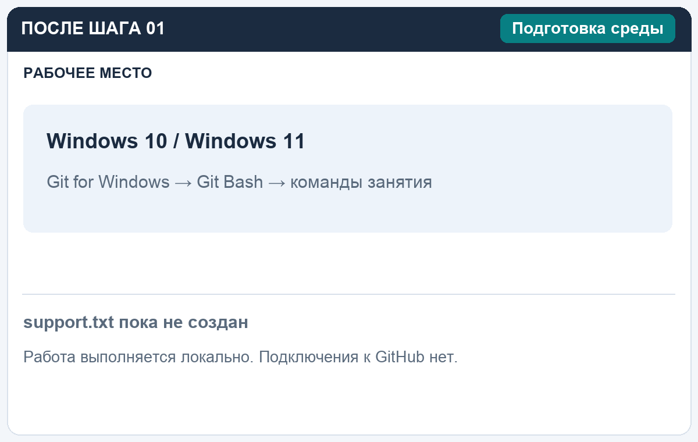
</td>
</tr>
</table>

### Шаг 2. Перейдите в свою папку пользователя

<table>
<tr>
<td width="48%" valign="top">
<p><strong>Основная команда — введите в Git Bash:</strong></p>
<pre class="command"><code>cd ~</code></pre>
<div class="command-parts"><p><strong>Разбор команды по частям</strong></p><ul><li><code>cd</code> — Команда оболочки: меняет текущую папку терминала.</li><li><code>~</code> — Домашняя папка текущего пользователя Windows.</li></ul></div>
<p>Знак ~ означает домашнюю папку текущего пользователя Windows. Так путь не зависит от расположения рабочего стола и OneDrive.</p>
<p><strong>Как проверить результат</strong></p>
<p>Чтобы увидеть текущую папку, введите в том же окне Git Bash:</p>
<pre class="check-command"><code>pwd</code></pre><div class="command-parts"><p><strong>Разбор команды по частям</strong></p><ul><li><code>pwd</code> — Print working directory: печатает полный путь текущей папки. Дополнительных ключей и аргументов здесь нет.</li></ul></div>
<p><strong>Пример ответа — вводить его не нужно:</strong></p><pre class="expected-output"><samp>/c/Users/Student</samp></pre>
<p>Это полный путь домашней папки. Имя пользователя и диск могут отличаться от примера.</p>

</td>
<td width="52%" valign="top">
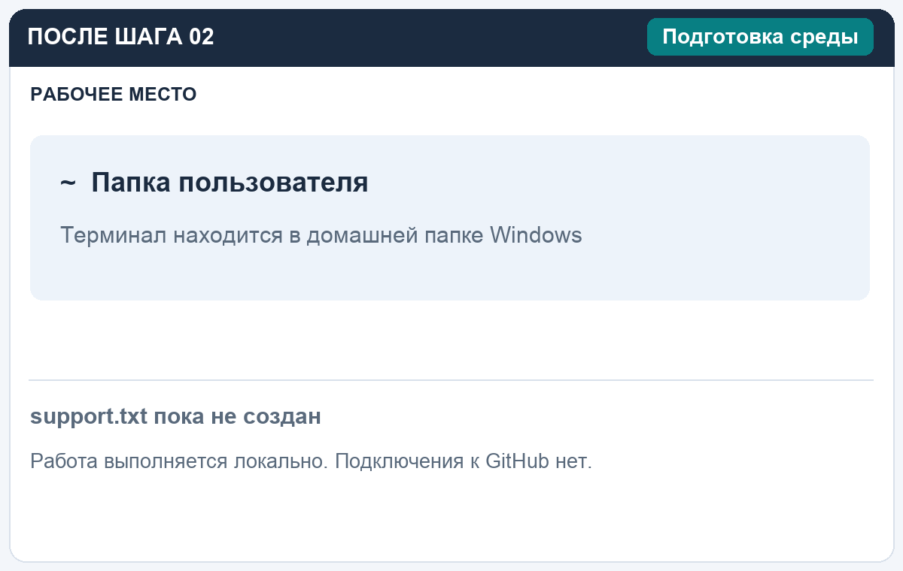
</td>
</tr>
</table>

### Шаг 3. Создайте отдельную папку занятия

<table>
<tr>
<td width="48%" valign="top">
<p><strong>Основная команда — введите в Git Bash:</strong></p>
<pre class="command"><code>mkdir git-branches-01</code></pre>
<div class="command-parts"><p><strong>Разбор команды по частям</strong></p><ul><li><code>mkdir</code> — Создаёт папку.</li><li><code>git-branches-01</code> — Имя новой папки; это обычное имя, а не настройка Git.</li></ul></div>
<p>mkdir создаёт новую папку. Если написано File exists, выберите другое имя, например git-branches-02, и используйте его также в следующем шаге.</p>
<p><strong>Как проверить результат</strong></p>
<p>Чтобы убедиться, что папка создана, введите:</p>
<pre class="check-command"><code>ls -d git-branches-01</code></pre><div class="command-parts"><p><strong>Разбор команды по частям</strong></p><ul><li><code>ls</code> — Показывает имена файлов или папок.</li><li><code>-d</code> — Показывает имя самой папки, а не её содержимое.</li><li><code>git-branches-01</code> — Имя папки, существование которой проверяется.</li></ul></div>
<p><strong>Что должно быть в ответе — вводить этот текст не нужно:</strong></p><pre class="expected-output"><samp>git-branches-01</samp></pre>
<p>Должно появиться имя папки. Если создали git-branches-02, замените имя и в команде проверки.</p>

</td>
<td width="52%" valign="top">

</td>
</tr>
</table>

### Шаг 4. Войдите в созданную папку

<table>
<tr>
<td width="48%" valign="top">
<p><strong>Основная команда — введите в Git Bash:</strong></p>
<pre class="command"><code>cd git-branches-01</code></pre>
<div class="command-parts"><p><strong>Разбор команды по частям</strong></p><ul><li><code>cd</code> — Команда оболочки: меняет текущую папку терминала.</li><li><code>git-branches-01</code> — Имя папки, в которую нужно войти из текущей папки.</li></ul></div>
<p>cd меняет текущую папку терминала. Дальнейшие команды относятся только к этому учебному проекту.</p>
<p><strong>Как проверить результат</strong></p>
<p>Чтобы увидеть текущую папку, введите в том же окне Git Bash:</p>
<pre class="check-command"><code>pwd</code></pre><div class="command-parts"><p><strong>Разбор команды по частям</strong></p><ul><li><code>pwd</code> — Print working directory: печатает полный путь текущей папки. Дополнительных ключей и аргументов здесь нет.</li></ul></div>
<p><strong>Пример ответа — вводить его не нужно:</strong></p><pre class="expected-output"><samp>/c/Users/Student/git-branches-01</samp></pre>
<p>Путь должен заканчиваться на /git-branches-01 — либо на выбранное вами имя папки.</p>

</td>
<td width="52%" valign="top">
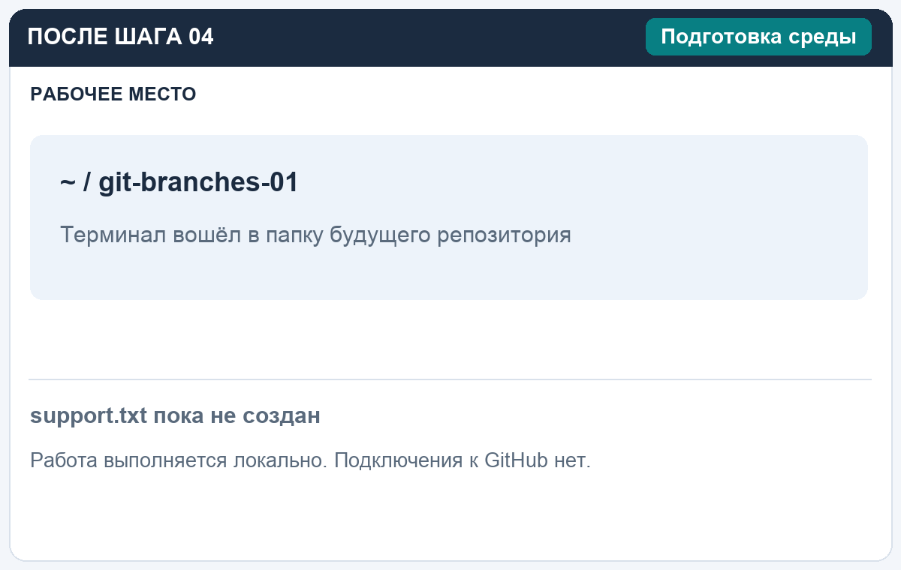
</td>
</tr>
</table>

### Шаг 5. Создайте репозиторий с основной веткой main

<table>
<tr>
<td width="48%" valign="top">
<p><strong>Основная команда — введите в Git Bash:</strong></p>
<pre class="command"><code>git init -b main</code></pre>
<div class="command-parts"><p><strong>Разбор команды по частям</strong></p><ul><li><code>git</code> — Запускает систему контроля версий Git.</li><li><code>init</code> — Создаёт репозиторий в текущей папке.</li><li><code>-b</code> — Задаёт имя начальной ветки: следующий аргумент main — это её имя.</li><li><code>main</code> — Основная ветка учебного проекта. Это имя ветки, а не ключ; дефис внутри имени не создаёт отдельный параметр.</li></ul></div>
<p>init создаёт служебную папку .git, в которой Git хранит историю. Параметр -b main сразу задаёт имя основной ветки. Коммитов пока нет.</p>
<p><strong>Как проверить результат</strong></p>
<p>В ответе на git init найдите следующий фрагмент. Дополнительную команду вводить не нужно.</p>

<p><strong>Что должно быть в ответе — вводить этот текст не нужно:</strong></p><pre class="expected-output"><samp>Initialized empty Git repository</samp></pre>
<p>После него Git покажет путь к .git. Если вместо Initialized написано Reinitialized, начните со шага 2 в новой папке.</p>
<div class="backup-preparation"><p><strong>Перед шагом 6: сохраните настройки для последующего возврата</strong></p><p>Один раз, сразу после создания нового репозитория и до любых учебных настроек, выполните:</p><p><strong>Введите в том же окне Git Bash:</strong></p><pre class="service-command"><code>cp -n .git/config .git/config.before-lesson</code></pre><div class="command-parts"><p><strong>Разбор команды по частям</strong></p><ul><li><code>cp</code> — Копирует файл: сначала указывается источник, затем место назначения.</li><li><code>-n</code> — Не перезаписывает уже существующий файл назначения: исходная резервная копия сохраняется при повторном запуске.</li><li><code>.git/config</code> — Файл локальных настроек: .git — служебная папка, / разделяет части пути, config — имя файла конфигурации.</li><li><code>.git/config.before-lesson</code> — Копия до учебных настроек внутри .git. before-lesson — часть имени («до занятия»), а не команда Git.</li></ul></div><p>При успехе сообщений обычно нет. Проверьте наличие копии:</p><p><strong>Введите в том же окне Git Bash:</strong></p><pre class="service-command"><code>ls .git/config.before-lesson</code></pre><div class="command-parts"><p><strong>Разбор команды по частям</strong></p><ul><li><code>ls</code> — Показывает имена файлов или папок.</li><li><code>.git/config.before-lesson</code> — Копия до учебных настроек внутри .git. before-lesson — часть имени («до занятия»), а не команда Git.</li></ul></div><p><strong>В ответе должно быть имя .git/config.before-lesson. Этот ответ вводить не нужно.</strong> Копия находится внутри служебной папки, поэтому в коммиты не попадёт. Если файл копии уже есть, команда cp с -n не заменит его. Если вы выполняли шаги 6–11 раньше без копии, не создавайте её сейчас под видом исходной: используйте раздел в конце «Если старая версия уже выполнена без копии».</p></div>
</td>
<td width="52%" valign="top">
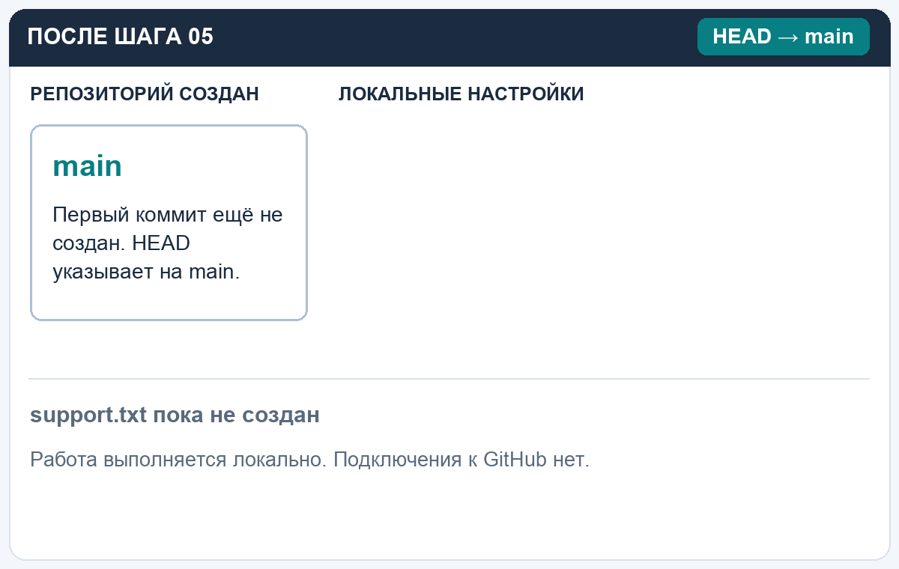
</td>
</tr>
</table>

### Шаг 6. Укажите автора коммитов

<table>
<tr>
<td width="48%" valign="top">
<p><strong>Основная команда — введите в Git Bash:</strong></p>
<pre class="command"><code>git config --local user.name &quot;Student&quot;</code></pre>
<div class="command-parts"><p><strong>Разбор команды по частям</strong></p><ul><li><code>git</code> — Запускает систему контроля версий Git.</li><li><code>config</code> — Читает или изменяет настройки Git; действие определяется последующими ключами и аргументами.</li><li><code>--local</code> — Ограничивает запись или чтение файлом .git/config только текущего репозитория.</li><li><code>user.name</code> — Один цельный ключ настройки, вводится без пробелов вокруг точки. user — раздел данных автора; точка . отделяет раздел от параметра; name — имя автора коммитов, а не логин GitHub.</li><li><code>&quot;Student&quot;</code> — Значение имени автора. Двойные кавычки объединяют текст в один аргумент и не записываются в значение. Можно указать своё имя.</li></ul></div>
<p>Вместо Student можно вписать своё имя латинскими буквами. Это подпись автора в истории проекта. --local сохраняет настройку только здесь.</p>
<p><strong>Как проверить результат</strong></p>
<p>Основная команда обычно ничего не печатает. Чтобы прочитать сохранённую настройку, введите:</p>
<pre class="check-command"><code>git config --local --get user.name</code></pre><div class="command-parts"><p><strong>Разбор команды по частям</strong></p><ul><li><code>git</code> — Запускает систему контроля версий Git.</li><li><code>config</code> — Читает или изменяет настройки Git; действие определяется последующими ключами и аргументами.</li><li><code>--local</code> — Ограничивает запись или чтение файлом .git/config только текущего репозитория.</li><li><code>--get</code> — Читает значение следующего ключа; ничего не изменяет. Если ключ не задан в выбранной области, вывода нет.</li><li><code>user.name</code> — Один цельный ключ настройки, вводится без пробелов вокруг точки. user — раздел данных автора; точка . отделяет раздел от параметра; name — имя автора коммитов, а не логин GitHub.</li></ul></div>
<p><strong>Что должно быть в ответе — вводить этот текст не нужно:</strong></p><pre class="expected-output"><samp>Student</samp></pre>
<p>Если указали своё имя вместо Student, в ответе должно быть именно ваше имя.</p>

</td>
<td width="52%" valign="top">
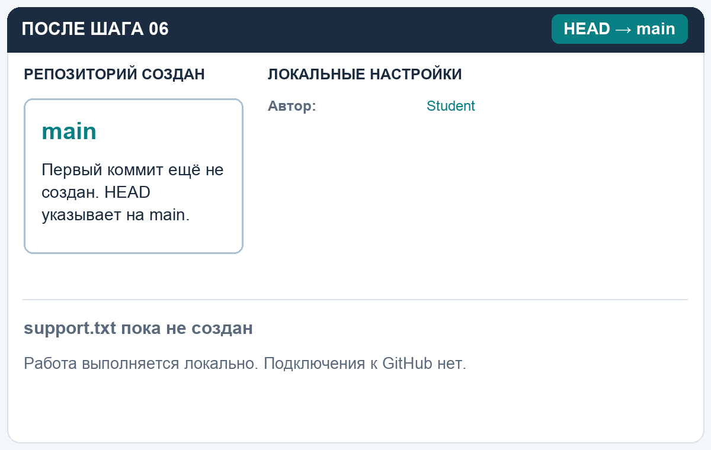
</td>
</tr>
</table>

### Шаг 7. Укажите учебный адрес автора

<table>
<tr>
<td width="48%" valign="top">
<p><strong>Основная команда — введите в Git Bash:</strong></p>
<pre class="command"><code>git config --local user.email &quot;student@example.invalid&quot;</code></pre>
<div class="command-parts"><p><strong>Разбор команды по частям</strong></p><ul><li><code>git</code> — Запускает систему контроля версий Git.</li><li><code>config</code> — Читает или изменяет настройки Git; действие определяется последующими ключами и аргументами.</li><li><code>--local</code> — Ограничивает запись или чтение файлом .git/config только текущего репозитория.</li><li><code>user.email</code> — Один цельный ключ настройки, вводится без пробелов вокруг точки. user — раздел данных автора; точка . — разделитель; email — адрес автора, записываемый в коммиты.</li><li><code>&quot;student@example.invalid&quot;</code> — Учебный адрес автора. @ отделяет имя от домена; это значение, а не вход в аккаунт. Кавычки группируют текст и в адрес не входят.</li></ul></div>
<p>Учебный адрес записывается в коммиты. Это не вход в GitHub: пароль, токен и подтверждение почты не нужны.</p>
<p><strong>Как проверить результат</strong></p>
<p>Основная команда обычно ничего не печатает. Чтобы прочитать сохранённую настройку, введите:</p>
<pre class="check-command"><code>git config --local --get user.email</code></pre><div class="command-parts"><p><strong>Разбор команды по частям</strong></p><ul><li><code>git</code> — Запускает систему контроля версий Git.</li><li><code>config</code> — Читает или изменяет настройки Git; действие определяется последующими ключами и аргументами.</li><li><code>--local</code> — Ограничивает запись или чтение файлом .git/config только текущего репозитория.</li><li><code>--get</code> — Читает значение следующего ключа; ничего не изменяет. Если ключ не задан в выбранной области, вывода нет.</li><li><code>user.email</code> — Один цельный ключ настройки, вводится без пробелов вокруг точки. user — раздел данных автора; точка . — разделитель; email — адрес автора, записываемый в коммиты.</li></ul></div>
<p><strong>Что должно быть в ответе — вводить этот текст не нужно:</strong></p><pre class="expected-output"><samp>student@example.invalid</samp></pre>
<p>Если ответ совпадает, переходите к следующему шагу. Команда проверки только читает настройку.</p>

</td>
<td width="52%" valign="top">
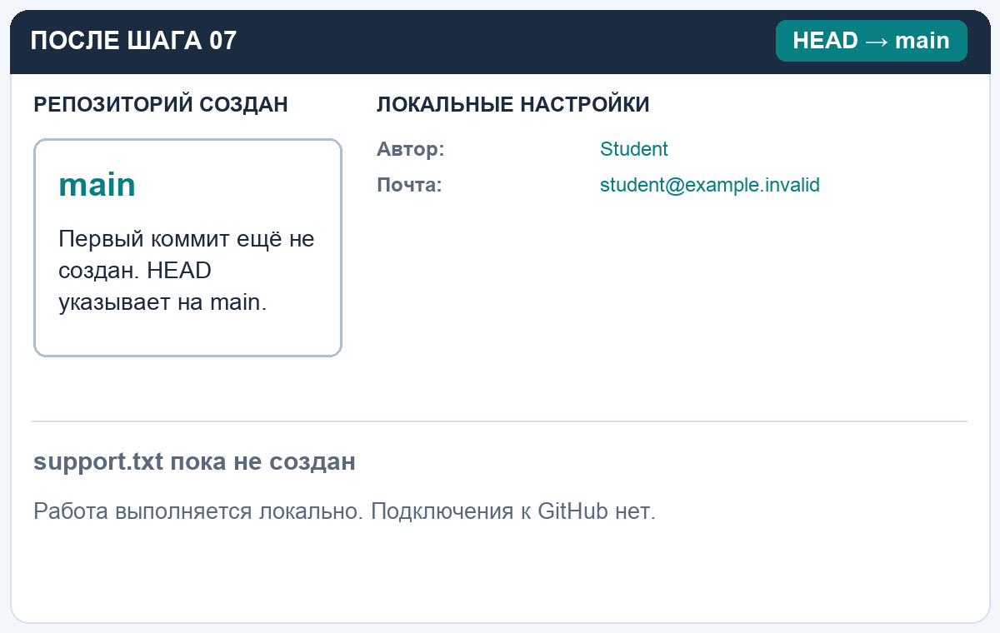
</td>
</tr>
</table>

### Шаг 8. Отключите обязательную подпись учебных коммитов

<table>
<tr>
<td width="48%" valign="top">
<p><strong>Основная команда — введите в Git Bash:</strong></p>
<pre class="command"><code>git config --local commit.gpgsign false</code></pre>
<div class="command-parts"><p><strong>Разбор команды по частям</strong></p><ul><li><code>git</code> — Запускает систему контроля версий Git.</li><li><code>config</code> — Читает или изменяет настройки Git; действие определяется последующими ключами и аргументами.</li><li><code>--local</code> — Ограничивает запись или чтение файлом .git/config только текущего репозитория.</li><li><code>commit.gpgsign</code> — Один цельный ключ настройки, вводится без пробелов вокруг точки. commit — раздел настроек коммитов; точка . — разделитель; gpgsign — автоматическая криптографическая подпись коммитов.</li><li><code>false</code> — Логическое значение «выключено»: отключает параметр, названный перед ним.</li></ul></div>
<p>Коммитам этого упражнения не нужна криптографическая подпись. Настройка предотвращает запрос чужого ключа подписи на общем компьютере.</p>
<p><strong>Как проверить результат</strong></p>
<p>Основная команда обычно ничего не печатает. Чтобы прочитать сохранённую настройку, введите:</p>
<pre class="check-command"><code>git config --local --get commit.gpgsign</code></pre><div class="command-parts"><p><strong>Разбор команды по частям</strong></p><ul><li><code>git</code> — Запускает систему контроля версий Git.</li><li><code>config</code> — Читает или изменяет настройки Git; действие определяется последующими ключами и аргументами.</li><li><code>--local</code> — Ограничивает запись или чтение файлом .git/config только текущего репозитория.</li><li><code>--get</code> — Читает значение следующего ключа; ничего не изменяет. Если ключ не задан в выбранной области, вывода нет.</li><li><code>commit.gpgsign</code> — Один цельный ключ настройки, вводится без пробелов вокруг точки. commit — раздел настроек коммитов; точка . — разделитель; gpgsign — автоматическая криптографическая подпись коммитов.</li></ul></div>
<p><strong>Что должно быть в ответе — вводить этот текст не нужно:</strong></p><pre class="expected-output"><samp>false</samp></pre>
<p>Если ответ совпадает, переходите к следующему шагу. Команда проверки только читает настройку.</p>

</td>
<td width="52%" valign="top">
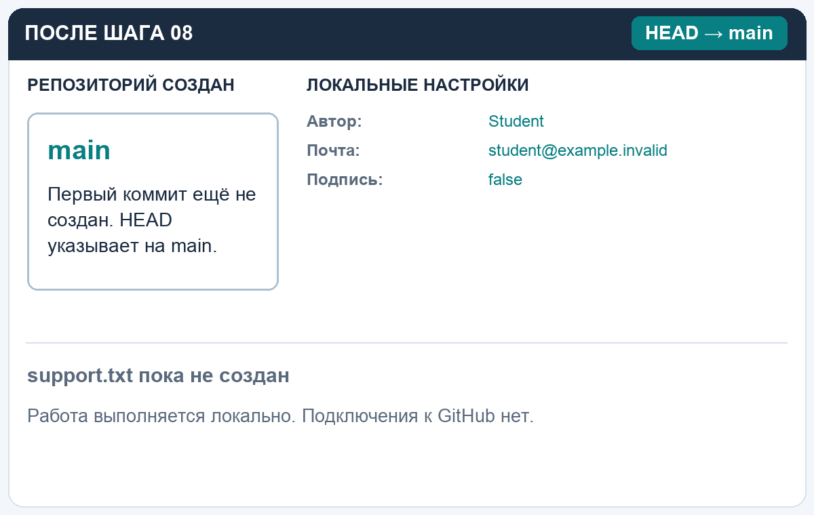
</td>
</tr>
</table>

### Шаг 9. Исключите посторонние обработчики коммитов

<table>
<tr>
<td width="48%" valign="top">
<p><strong>Основная команда — введите в Git Bash:</strong></p>
<pre class="command"><code>git config --local core.hooksPath .git/lesson-hooks</code></pre>
<div class="command-parts"><p><strong>Разбор команды по частям</strong></p><ul><li><code>git</code> — Запускает систему контроля версий Git.</li><li><code>config</code> — Читает или изменяет настройки Git; действие определяется последующими ключами и аргументами.</li><li><code>--local</code> — Ограничивает запись или чтение файлом .git/config только текущего репозитория.</li><li><code>core.hooksPath</code> — Один цельный ключ настройки, вводится без пробелов вокруг точки. core — раздел основных настроек; точка . — разделитель; hooksPath — путь к обработчикам действий Git.</li><li><code>.git/lesson-hooks</code> — Путь: .git — служебная папка репозитория, / — разделитель пути, lesson-hooks — выбранное имя папки обработчиков. В упражнении её нет, поэтому обработчики не запускаются.</li></ul></div>
<p>Git будет искать обработчики действий в отдельном учебном пути. В новом репозитории там ничего нет; чужие глобальные обработчики не запускаются.</p>
<p><strong>Как проверить результат</strong></p>
<p>Основная команда обычно ничего не печатает. Чтобы прочитать сохранённую настройку, введите:</p>
<pre class="check-command"><code>git config --local --get core.hooksPath</code></pre><div class="command-parts"><p><strong>Разбор команды по частям</strong></p><ul><li><code>git</code> — Запускает систему контроля версий Git.</li><li><code>config</code> — Читает или изменяет настройки Git; действие определяется последующими ключами и аргументами.</li><li><code>--local</code> — Ограничивает запись или чтение файлом .git/config только текущего репозитория.</li><li><code>--get</code> — Читает значение следующего ключа; ничего не изменяет. Если ключ не задан в выбранной области, вывода нет.</li><li><code>core.hooksPath</code> — Один цельный ключ настройки, вводится без пробелов вокруг точки. core — раздел основных настроек; точка . — разделитель; hooksPath — путь к обработчикам действий Git.</li></ul></div>
<p><strong>Что должно быть в ответе — вводить этот текст не нужно:</strong></p><pre class="expected-output"><samp>.git/lesson-hooks</samp></pre>
<p>Если ответ совпадает, переходите к следующему шагу. Команда проверки только читает настройку.</p>

</td>
<td width="52%" valign="top">
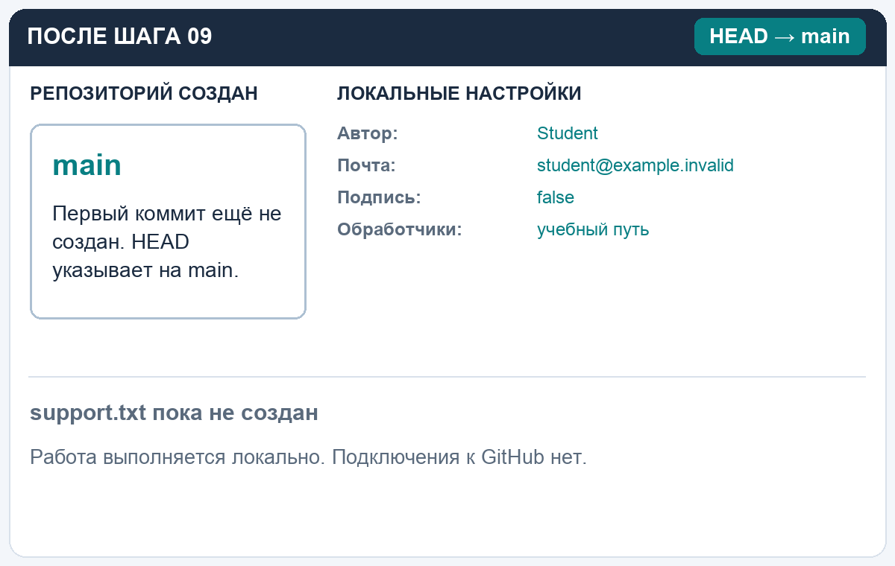
</td>
</tr>
</table>

### Шаг 10. Задайте одинаковый вид конфликтов

<table>
<tr>
<td width="48%" valign="top">
<p><strong>Основная команда — введите в Git Bash:</strong></p>
<pre class="command"><code>git config --local merge.conflictStyle merge</code></pre>
<div class="command-parts"><p><strong>Разбор команды по частям</strong></p><ul><li><code>git</code> — Запускает систему контроля версий Git.</li><li><code>config</code> — Читает или изменяет настройки Git; действие определяется последующими ключами и аргументами.</li><li><code>--local</code> — Ограничивает запись или чтение файлом .git/config только текущего репозитория.</li><li><code>merge.conflictStyle</code> — Один цельный ключ настройки, вводится без пробелов вокруг точки. merge — раздел настроек слияния; точка . — разделитель; conflictStyle — формат конфликтных фрагментов в файле.</li><li><code>merge</code> — Значение conflictStyle: показывать две конфликтующие версии и разделители. Здесь merge — значение настройки, а не команда слияния.</li></ul></div>
<p>В конфликтном файле будут показаны две версии текста и разделители между ними. Это делает результат одинаковым при разных настройках компьютеров.</p>
<p><strong>Как проверить результат</strong></p>
<p>Основная команда обычно ничего не печатает. Чтобы прочитать сохранённую настройку, введите:</p>
<pre class="check-command"><code>git config --local --get merge.conflictStyle</code></pre><div class="command-parts"><p><strong>Разбор команды по частям</strong></p><ul><li><code>git</code> — Запускает систему контроля версий Git.</li><li><code>config</code> — Читает или изменяет настройки Git; действие определяется последующими ключами и аргументами.</li><li><code>--local</code> — Ограничивает запись или чтение файлом .git/config только текущего репозитория.</li><li><code>--get</code> — Читает значение следующего ключа; ничего не изменяет. Если ключ не задан в выбранной области, вывода нет.</li><li><code>merge.conflictStyle</code> — Один цельный ключ настройки, вводится без пробелов вокруг точки. merge — раздел настроек слияния; точка . — разделитель; conflictStyle — формат конфликтных фрагментов в файле.</li></ul></div>
<p><strong>Что должно быть в ответе — вводить этот текст не нужно:</strong></p><pre class="expected-output"><samp>merge</samp></pre>
<p>Если ответ совпадает, переходите к следующему шагу. Команда проверки только читает настройку.</p>

</td>
<td width="52%" valign="top">
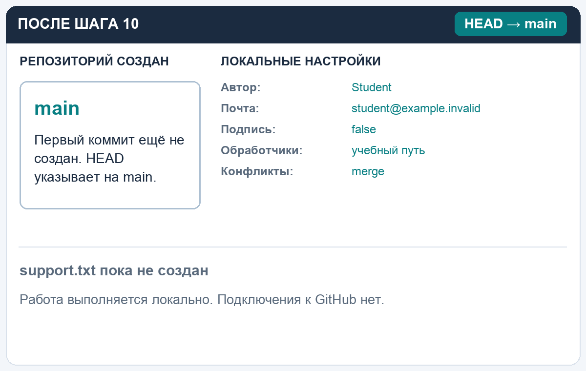
</td>
</tr>
</table>

### Шаг 11. Сохраните единый формат строк

<table>
<tr>
<td width="48%" valign="top">
<p><strong>Основная команда — введите в Git Bash:</strong></p>
<pre class="command"><code>git config --local core.autocrlf false</code></pre>
<div class="command-parts"><p><strong>Разбор команды по частям</strong></p><ul><li><code>git</code> — Запускает систему контроля версий Git.</li><li><code>config</code> — Читает или изменяет настройки Git; действие определяется последующими ключами и аргументами.</li><li><code>--local</code> — Ограничивает запись или чтение файлом .git/config только текущего репозитория.</li><li><code>core.autocrlf</code> — Один цельный ключ настройки, вводится без пробелов вокруг точки. core — раздел основных настроек; точка . — разделитель; autocrlf — автоматическое преобразование окончаний строк CRLF и LF.</li><li><code>false</code> — Логическое значение «выключено»: отключает параметр, названный перед ним.</li></ul></div>
<p>Git не будет автоматически менять окончания строк. Файл создаётся командами Git Bash, поэтому во всём упражнении используется один формат.</p>
<p><strong>Как проверить результат</strong></p>
<p>Основная команда обычно ничего не печатает. Чтобы прочитать сохранённую настройку, введите:</p>
<pre class="check-command"><code>git config --local --get core.autocrlf</code></pre><div class="command-parts"><p><strong>Разбор команды по частям</strong></p><ul><li><code>git</code> — Запускает систему контроля версий Git.</li><li><code>config</code> — Читает или изменяет настройки Git; действие определяется последующими ключами и аргументами.</li><li><code>--local</code> — Ограничивает запись или чтение файлом .git/config только текущего репозитория.</li><li><code>--get</code> — Читает значение следующего ключа; ничего не изменяет. Если ключ не задан в выбранной области, вывода нет.</li><li><code>core.autocrlf</code> — Один цельный ключ настройки, вводится без пробелов вокруг точки. core — раздел основных настроек; точка . — разделитель; autocrlf — автоматическое преобразование окончаний строк CRLF и LF.</li></ul></div>
<p><strong>Что должно быть в ответе — вводить этот текст не нужно:</strong></p><pre class="expected-output"><samp>false</samp></pre>
<p>Если ответ совпадает, переходите к следующему шагу. Команда проверки только читает настройку.</p>

</td>
<td width="52%" valign="top">
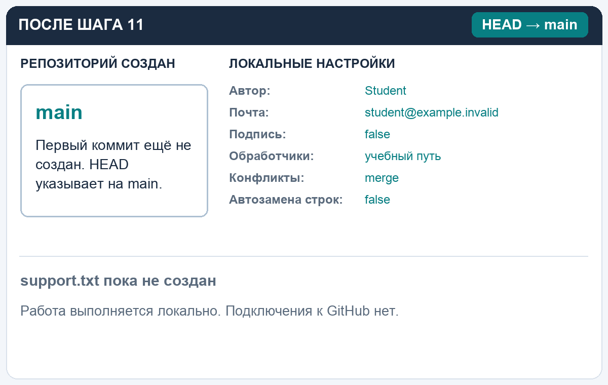
</td>
</tr>
</table>


## 2. Исходная версия проекта

### Шаг 12. Создайте карточку службы поддержки

<table>
<tr>
<td width="48%" valign="top">
<p><strong>Основная команда — введите в Git Bash:</strong></p>
<pre class="command"><code>printf &#x27;%s\n&#x27; &#x27;Service: Help Desk&#x27; &#x27;Email: help@old.example&#x27; &#x27;Hours: 09:00-18:00&#x27; &gt; support.txt</code></pre>
<div class="command-parts"><p><strong>Разбор команды по частям</strong></p><ul><li><code>printf</code> — Форматирует и выводит строки; здесь результат направляется в файл.</li><li><code>&#x27;%s\n&#x27;</code> — Строка формата в одинарных кавычках: %s подставляет очередной строковый аргумент, \n добавляет перевод строки. Формат повторяется для каждого переданного текста.</li><li><code>&#x27;Service: Help Desk&#x27;</code> — Один строковый аргумент — соответствующая строка карточки. Одинарные кавычки сохраняют пробелы внутри текста и сами в файл не попадают.</li><li><code>&#x27;Email: help@old.example&#x27;</code> — Один строковый аргумент — соответствующая строка карточки. Одинарные кавычки сохраняют пробелы внутри текста и сами в файл не попадают.</li><li><code>&#x27;Hours: 09:00-18:00&#x27;</code> — Один строковый аргумент — соответствующая строка карточки. Одинарные кавычки сохраняют пробелы внутри текста и сами в файл не попадают.</li><li><code>&gt;</code> — Оператор Git Bash: заменяет содержимое файла выводом команды; при отсутствии создаёт файл.</li><li><code>support.txt</code> — Файл, в который направляется вывод printf; расположен в текущей учебной папке.</li></ul></div>
<p>printf записывает три строки в support.txt; &gt; создаёт файл или заменяет его содержимое. В первой версии указан старый адрес. \n в команде означает переход на новую строку.</p>
<p><strong>Как проверить результат</strong></p>
<p>Команда записи ничего не печатает. Чтобы увидеть, что теперь находится в файле, введите:</p>
<pre class="check-command"><code>cat support.txt</code></pre><div class="command-parts"><p><strong>Разбор команды по частям</strong></p><ul><li><code>cat</code> — Выводит содержимое указанного файла в терминал.</li><li><code>support.txt</code> — Имя читаемого файла карточки. Команда не изменяет файл.</li></ul></div>
<p><strong>Что должно быть в ответе — вводить этот текст не нужно:</strong></p><pre class="expected-output"><samp>Service: Help Desk
Email: help@old.example
Hours: 09:00-18:00</samp></pre>
<p>Сравните три строки с образцом. Если они совпадают, файл записан правильно; открывать его в редакторе не требуется.</p>

</td>
<td width="52%" valign="top">
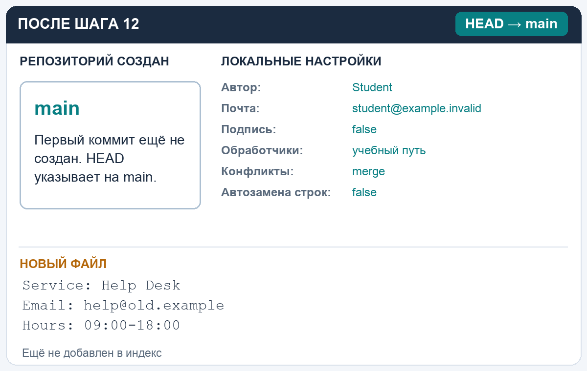
</td>
</tr>
</table>

### Шаг 13. Подготовьте файл к сохранению

<table>
<tr>
<td width="48%" valign="top">
<p><strong>Основная команда — введите в Git Bash:</strong></p>
<pre class="command"><code>git add support.txt</code></pre>
<div class="command-parts"><p><strong>Разбор команды по частям</strong></p><ul><li><code>git</code> — Запускает систему контроля версий Git.</li><li><code>add</code> — Помещает выбранную версию файла в индекс; во время слияния также отмечает конфликт решённым.</li><li><code>support.txt</code> — Имя файла карточки в текущей папке; .txt — расширение текстового файла.</li></ul></div>
<p>add помещает текущее содержимое support.txt в индекс — набор изменений для ближайшего коммита. Сам коммит ещё не создан.</p>
<p><strong>Как проверить результат</strong></p>
<p>После add обычно нет сообщения. Чтобы увидеть подготовленное изменение, введите:</p>
<pre class="check-command"><code>git status</code></pre><div class="command-parts"><p><strong>Разбор команды по частям</strong></p><ul><li><code>git</code> — Запускает систему контроля версий Git.</li><li><code>status</code> — Показывает текущую ветку, подготовленные и неподготовленные изменения, состояние слияния.</li></ul></div>
<p><strong>Что должно быть в ответе — вводить этот текст не нужно:</strong></p><pre class="expected-output"><samp>Changes to be committed:
  new file:   support.txt</samp></pre>
<p>Найдите файл именно под заголовком Changes to be committed. Это означает, что он подготовлен к коммиту. Отступы в вашем окне могут отличаться.</p>

</td>
<td width="52%" valign="top">
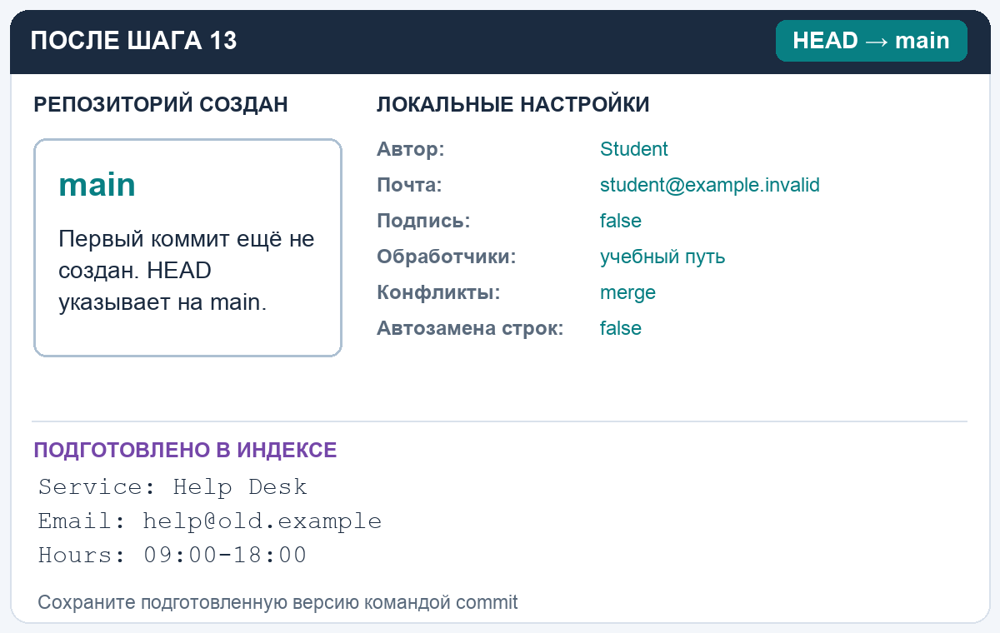
</td>
</tr>
</table>

### Шаг 14. Создайте первый коммит

<table>
<tr>
<td width="48%" valign="top">
<p><strong>Основная команда — введите в Git Bash:</strong></p>
<pre class="command"><code>git commit -m &quot;Initial support card&quot;</code></pre>
<div class="command-parts"><p><strong>Разбор команды по частям</strong></p><ul><li><code>git</code> — Запускает систему контроля версий Git.</li><li><code>commit</code> — Создаёт коммит из подготовленного содержимого индекса.</li><li><code>-m</code> — Следующий аргумент — сообщение коммита; редактор сообщения не открывается.</li><li><code>&quot;Initial support card&quot;</code> — Текст сообщения этого коммита. Пробелы находятся внутри двойных кавычек, поэтому весь текст передаётся одним аргументом; сами кавычки не сохраняются.</li></ul></div>
<p>commit сохраняет подготовленное содержимое в истории; -m задаёт сообщение. На схеме первый коммит обозначен A.</p>
<p><strong>Как проверить результат</strong></p>
<p>Посмотрите ответ Git под выполненной командой commit и найдите в нём это сообщение. Дополнительную команду вводить не нужно.</p>

<p><strong>Что должно быть в ответе — вводить этот текст не нужно:</strong></p><pre class="expected-output"><samp>Initial support card</samp></pre>
<p>Перед сообщением Git покажет имя ветки и идентификатор коммита. Идентификатор у вас будет свой; сравнивать его с буквами на схеме не нужно.</p>

</td>
<td width="52%" valign="top">
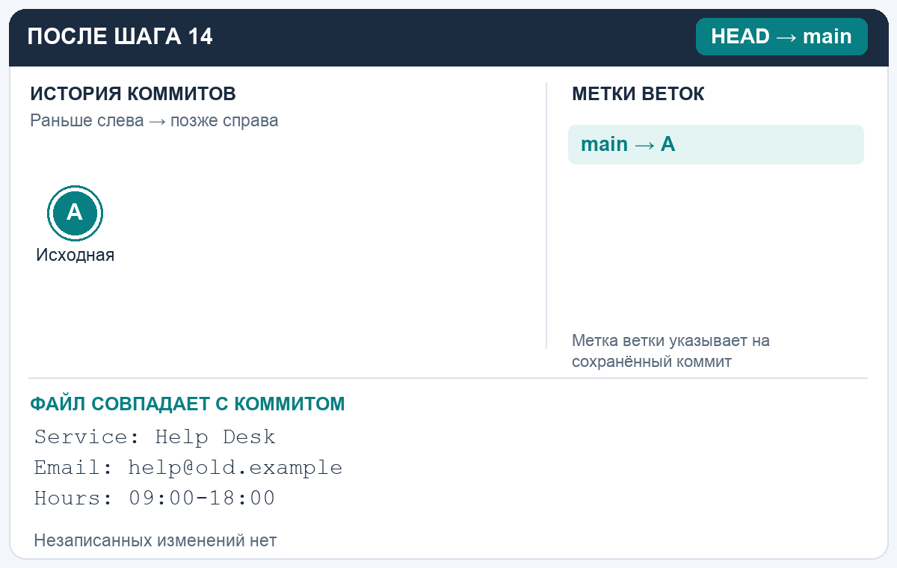
</td>
</tr>
</table>


## 3. Исправление в отдельной ветке

### Шаг 15. Создайте ветку fix-email и переключитесь в неё

<table>
<tr>
<td width="48%" valign="top">
<p><strong>Основная команда — введите в Git Bash:</strong></p>
<pre class="command"><code>git switch -c fix-email</code></pre>
<div class="command-parts"><p><strong>Разбор команды по частям</strong></p><ul><li><code>git</code> — Запускает систему контроля версий Git.</li><li><code>switch</code> — Переключает текущую ветку; с ключом -c сначала создаёт новую.</li><li><code>-c</code> — Создаёт новую ветку с именем из следующего аргумента и переключается в неё.</li><li><code>fix-email</code> — Ветка исправления адреса электронной почты. Это имя ветки, а не ключ; дефис внутри имени не создаёт отдельный параметр.</li></ul></div>
<p>switch переключает ветку, а -c сначала создаёт её. Новая ветка начинается с текущего коммита A. В этот момент файлы обеих веток одинаковы.</p>
<p><strong>Как проверить результат</strong></p>
<p>Чтобы точно узнать, какая ветка сейчас выбрана, введите:</p>
<pre class="check-command"><code>git branch --show-current</code></pre><div class="command-parts"><p><strong>Разбор команды по частям</strong></p><ul><li><code>git</code> — Запускает систему контроля версий Git.</li><li><code>branch</code> — Без ключей показывает список локальных веток.</li><li><code>--show-current</code> — Выводит только имя текущей ветки.</li></ul></div>
<p><strong>Что должно быть в ответе — вводить этот текст не нужно:</strong></p><pre class="expected-output"><samp>fix-email</samp></pre>
<p>Ответ должен состоять из этого имени. Это имя текущей ветки, а не команда, которую нужно выполнить.</p>

</td>
<td width="52%" valign="top">
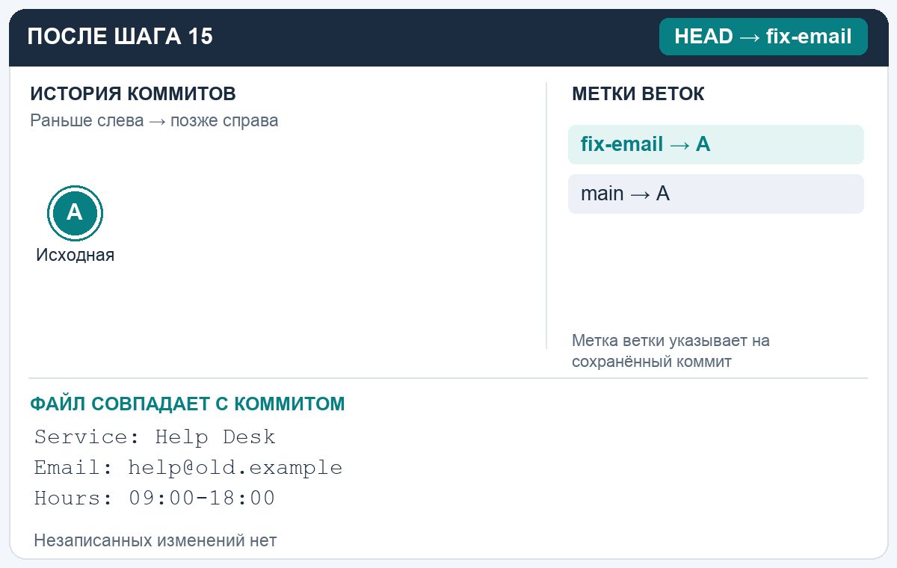
</td>
</tr>
</table>

### Шаг 16. Исправьте адрес в рабочем файле

<table>
<tr>
<td width="48%" valign="top">
<p><strong>Основная команда — введите в Git Bash:</strong></p>
<pre class="command"><code>printf &#x27;%s\n&#x27; &#x27;Service: Help Desk&#x27; &#x27;Email: help@college.example&#x27; &#x27;Hours: 09:00-18:00&#x27; &gt; support.txt</code></pre>
<div class="command-parts"><p><strong>Разбор команды по частям</strong></p><ul><li><code>printf</code> — Форматирует и выводит строки; здесь результат направляется в файл.</li><li><code>&#x27;%s\n&#x27;</code> — Строка формата в одинарных кавычках: %s подставляет очередной строковый аргумент, \n добавляет перевод строки. Формат повторяется для каждого переданного текста.</li><li><code>&#x27;Service: Help Desk&#x27;</code> — Один строковый аргумент — соответствующая строка карточки. Одинарные кавычки сохраняют пробелы внутри текста и сами в файл не попадают.</li><li><code>&#x27;Email: help@college.example&#x27;</code> — Один строковый аргумент — соответствующая строка карточки. Одинарные кавычки сохраняют пробелы внутри текста и сами в файл не попадают.</li><li><code>&#x27;Hours: 09:00-18:00&#x27;</code> — Один строковый аргумент — соответствующая строка карточки. Одинарные кавычки сохраняют пробелы внутри текста и сами в файл не попадают.</li><li><code>&gt;</code> — Оператор Git Bash: заменяет содержимое файла выводом команды; при отсутствии создаёт файл.</li><li><code>support.txt</code> — Файл, в который направляется вывод printf; расположен в текущей учебной папке.</li></ul></div>
<p>В support.txt записан адрес help@college.example. Это пока изменение рабочего файла: коммит A и основная ветка main остаются прежними.</p>
<p><strong>Как проверить результат</strong></p>
<p>Команда записи ничего не печатает. Чтобы увидеть, что теперь находится в файле, введите:</p>
<pre class="check-command"><code>cat support.txt</code></pre><div class="command-parts"><p><strong>Разбор команды по частям</strong></p><ul><li><code>cat</code> — Выводит содержимое указанного файла в терминал.</li><li><code>support.txt</code> — Имя читаемого файла карточки. Команда не изменяет файл.</li></ul></div>
<p><strong>Что должно быть в ответе — вводить этот текст не нужно:</strong></p><pre class="expected-output"><samp>Service: Help Desk
Email: help@college.example
Hours: 09:00-18:00</samp></pre>
<p>Сравните три строки с образцом. Если они совпадают, файл записан правильно; открывать его в редакторе не требуется.</p>

</td>
<td width="52%" valign="top">
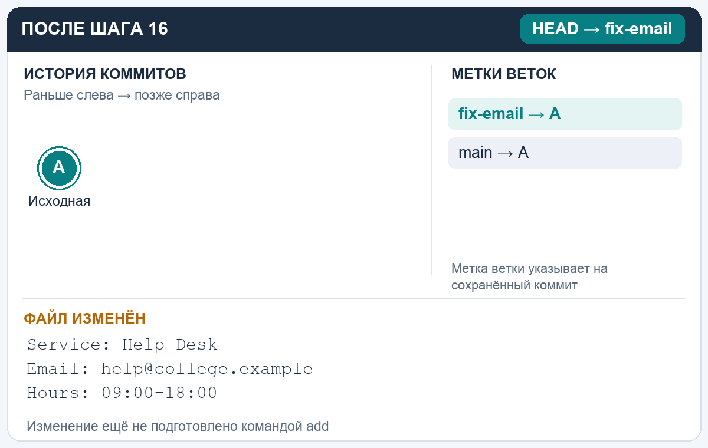
</td>
</tr>
</table>

### Шаг 17. Посмотрите, что изменилось

<table>
<tr>
<td width="48%" valign="top">
<p><strong>Основная команда — введите в Git Bash:</strong></p>
<pre class="command"><code>git --no-pager diff</code></pre>
<div class="command-parts"><p><strong>Разбор команды по частям</strong></p><ul><li><code>git</code> — Запускает систему контроля версий Git.</li><li><code>--no-pager</code> — Общий ключ Git: выводит ответ прямо в терминал, без отдельного просмотрщика.</li><li><code>diff</code> — Показывает различия; без дополнительных ключей сравнивает рабочие файлы с индексом.</li></ul></div>
<p>diff сравнивает рабочие файлы с индексом. Строка с - показывает старый адрес, с + — новый. --no-pager выводит результат прямо в терминал.</p>
<p><strong>Как проверить результат</strong></p>
<p>В уже появившемся выводе найдите строку с минусом и строку с плюсом. Дополнительную команду вводить не нужно.</p>

<p><strong>Что должно быть в ответе — вводить этот текст не нужно:</strong></p><pre class="expected-output"><samp>-Email: help@old.example
+Email: help@college.example</samp></pre>
<p>Минус обозначает убранную строку, плюс — добавленную. Заголовки и остальные строки diff повторять в терминале не нужно.</p>

</td>
<td width="52%" valign="top">

</td>
</tr>
</table>

### Шаг 18. Подготовьте исправление к коммиту

<table>
<tr>
<td width="48%" valign="top">
<p><strong>Основная команда — введите в Git Bash:</strong></p>
<pre class="command"><code>git add support.txt</code></pre>
<div class="command-parts"><p><strong>Разбор команды по частям</strong></p><ul><li><code>git</code> — Запускает систему контроля версий Git.</li><li><code>add</code> — Помещает выбранную версию файла в индекс; во время слияния также отмечает конфликт решённым.</li><li><code>support.txt</code> — Имя файла карточки в текущей папке; .txt — расширение текстового файла.</li></ul></div>
<p>В индекс помещается уже исправленная версия файла. После add в следующий коммит попадёт новый адрес.</p>
<p><strong>Как проверить результат</strong></p>
<p>После add обычно нет сообщения. Чтобы увидеть подготовленное изменение, введите:</p>
<pre class="check-command"><code>git status</code></pre><div class="command-parts"><p><strong>Разбор команды по частям</strong></p><ul><li><code>git</code> — Запускает систему контроля версий Git.</li><li><code>status</code> — Показывает текущую ветку, подготовленные и неподготовленные изменения, состояние слияния.</li></ul></div>
<p><strong>Что должно быть в ответе — вводить этот текст не нужно:</strong></p><pre class="expected-output"><samp>Changes to be committed:
  modified:   support.txt</samp></pre>
<p>Найдите файл именно под заголовком Changes to be committed. Это означает, что он подготовлен к коммиту. Отступы в вашем окне могут отличаться.</p>

</td>
<td width="52%" valign="top">
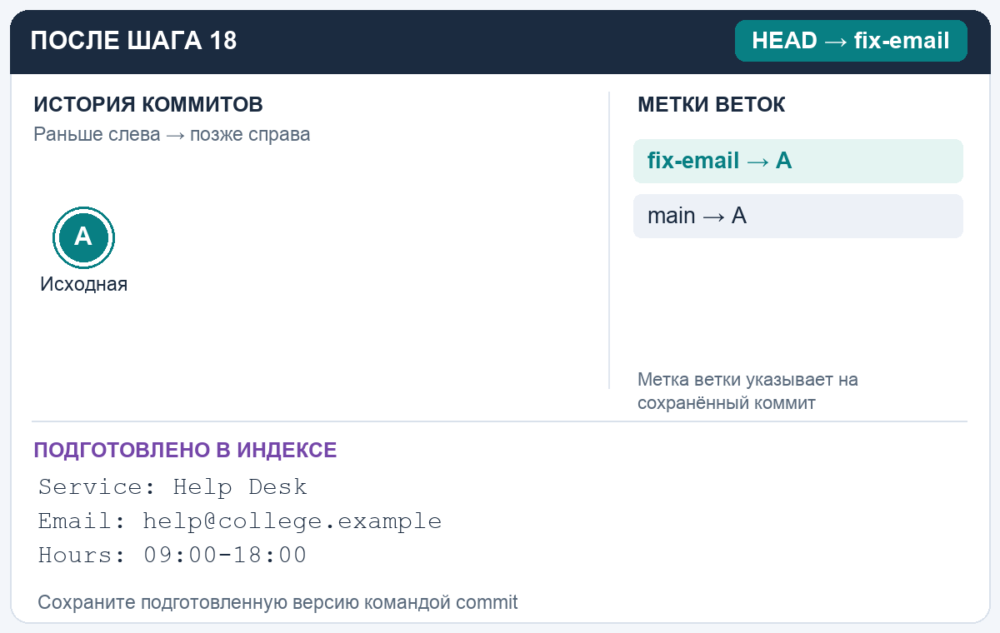
</td>
</tr>
</table>

### Шаг 19. Сохраните исправление в ветке fix-email

<table>
<tr>
<td width="48%" valign="top">
<p><strong>Основная команда — введите в Git Bash:</strong></p>
<pre class="command"><code>git commit -m &quot;Fix support email&quot;</code></pre>
<div class="command-parts"><p><strong>Разбор команды по частям</strong></p><ul><li><code>git</code> — Запускает систему контроля версий Git.</li><li><code>commit</code> — Создаёт коммит из подготовленного содержимого индекса.</li><li><code>-m</code> — Следующий аргумент — сообщение коммита; редактор сообщения не открывается.</li><li><code>&quot;Fix support email&quot;</code> — Текст сообщения этого коммита. Пробелы находятся внутри двойных кавычек, поэтому весь текст передаётся одним аргументом; сами кавычки не сохраняются.</li></ul></div>
<p>Создан коммит B, следующий за A. Метка fix-email переместилась на B; main по-прежнему указывает на A.</p>
<p><strong>Как проверить результат</strong></p>
<p>Посмотрите ответ Git под выполненной командой commit и найдите в нём это сообщение. Дополнительную команду вводить не нужно.</p>

<p><strong>Что должно быть в ответе — вводить этот текст не нужно:</strong></p><pre class="expected-output"><samp>Fix support email</samp></pre>
<p>Перед сообщением Git покажет имя ветки и идентификатор коммита. Идентификатор у вас будет свой; сравнивать его с буквами на схеме не нужно.</p>

</td>
<td width="52%" valign="top">
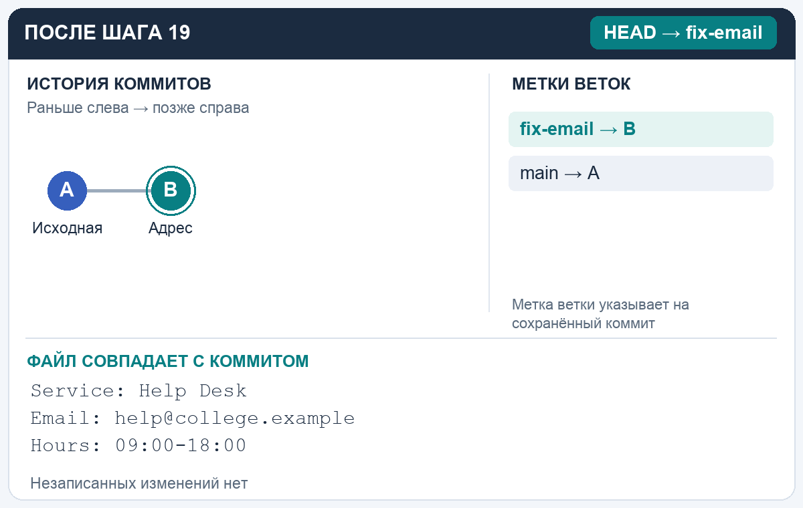
</td>
</tr>
</table>

### Шаг 20. Вернитесь в основную ветку

<table>
<tr>
<td width="48%" valign="top">
<p><strong>Основная команда — введите в Git Bash:</strong></p>
<pre class="command"><code>git switch main</code></pre>
<div class="command-parts"><p><strong>Разбор команды по частям</strong></p><ul><li><code>git</code> — Запускает систему контроля версий Git.</li><li><code>switch</code> — Переключает текущую ветку; с ключом -c сначала создаёт новую.</li><li><code>main</code> — Основная ветка учебного проекта. Это имя ветки, а не ключ; дефис внутри имени не создаёт отдельный параметр.</li></ul></div>
<p>Git восстанавливает в рабочей папке сохранённую версию main — коммит A. Поэтому в файле снова старый адрес. Исправление осталось в fix-email.</p>
<p><strong>Как проверить результат</strong></p>
<p>Чтобы точно узнать, какая ветка сейчас выбрана, введите:</p>
<pre class="check-command"><code>git branch --show-current</code></pre><div class="command-parts"><p><strong>Разбор команды по частям</strong></p><ul><li><code>git</code> — Запускает систему контроля версий Git.</li><li><code>branch</code> — Без ключей показывает список локальных веток.</li><li><code>--show-current</code> — Выводит только имя текущей ветки.</li></ul></div>
<p><strong>Что должно быть в ответе — вводить этот текст не нужно:</strong></p><pre class="expected-output"><samp>main</samp></pre>
<p>Ответ должен состоять из этого имени. Это имя текущей ветки, а не команда, которую нужно выполнить.</p>

</td>
<td width="52%" valign="top">

</td>
</tr>
</table>

### Шаг 21. Проверьте содержимое основной ветки

<table>
<tr>
<td width="48%" valign="top">
<p><strong>Основная команда — введите в Git Bash:</strong></p>
<pre class="command"><code>cat support.txt</code></pre>
<div class="command-parts"><p><strong>Разбор команды по частям</strong></p><ul><li><code>cat</code> — Выводит содержимое указанного файла в терминал.</li><li><code>support.txt</code> — Имя читаемого файла карточки. Команда не изменяет файл.</li></ul></div>
<p>cat выводит файл в терминал. Убедитесь, что переключение ветки действительно изменило содержимое той же самой рабочей папки.</p>
<p><strong>Как проверить результат</strong></p>
<p>Команда cat уже показала файл в терминале. Посмотрите её ответ; повторно вводить команду не нужно.</p>

<p><strong>Что должно быть в ответе — вводить этот текст не нужно:</strong></p><pre class="expected-output"><samp>Service: Help Desk
Email: help@old.example
Hours: 09:00-18:00</samp></pre>
<p>Сравните уже выведенные строки с образцом. Дополнительных действий на этом шаге нет.</p>

</td>
<td width="52%" valign="top">
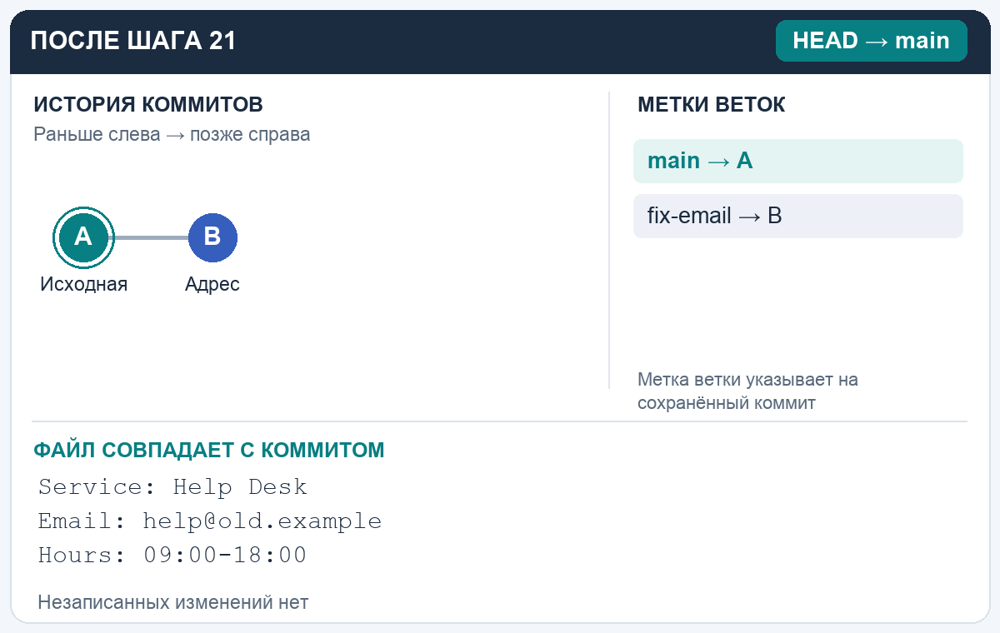
</td>
</tr>
</table>

### Шаг 22. Включите исправление в main

<table>
<tr>
<td width="48%" valign="top">
<p><strong>Основная команда — введите в Git Bash:</strong></p>
<pre class="command"><code>git merge --ff-only fix-email</code></pre>
<div class="command-parts"><p><strong>Разбор команды по частям</strong></p><ul><li><code>git</code> — Запускает систему контроля версий Git.</li><li><code>merge</code> — Объединяет указанную ветку с текущей.</li><li><code>--ff-only</code> — Разрешает слияние только перемещением текущей ветки вперёд по существующей истории. При расхождении линий операция будет отклонена.</li><li><code>fix-email</code> — Ветка исправления адреса электронной почты. Это имя ветки, а не ключ; дефис внутри имени не создаёт отдельный параметр.</li></ul></div>
<p>merge объединяет указанную ветку с текущей — main. Здесь main можно просто передвинуть с A на B: это fast-forward. --ff-only разрешает только такой способ.</p>
<p><strong>Как проверить результат</strong></p>
<p>Посмотрите ответ Git сразу под командой merge. Дополнительную команду вводить не нужно.</p>

<p><strong>Что должно быть в ответе — вводить этот текст не нужно:</strong></p><pre class="expected-output"><samp>Fast-forward</samp></pre>
<p>Найдите эту строку среди остальных сообщений. Она означает, что текущая ветка передвинулась на уже существующий коммит, как на схеме справа.</p>

</td>
<td width="52%" valign="top">
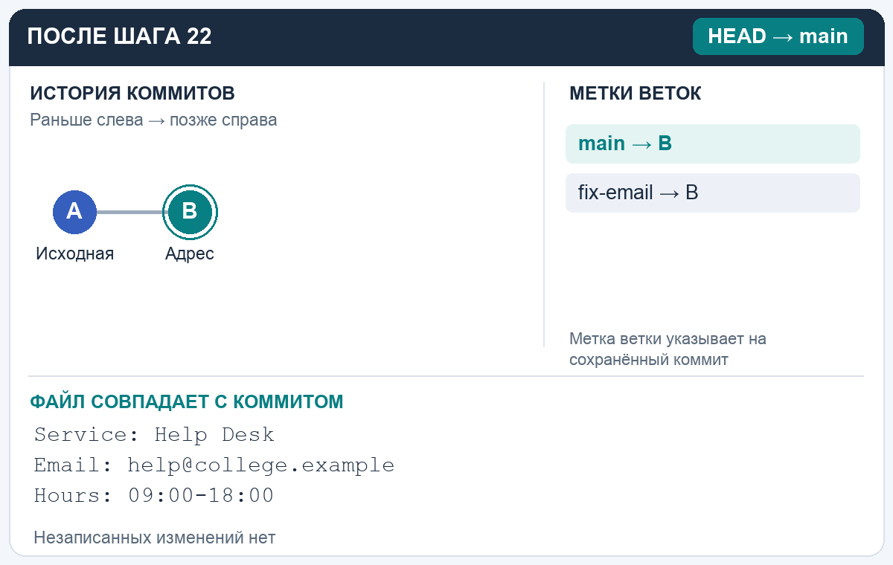
</td>
</tr>
</table>


## 4. Две независимые версии графика работы

### Шаг 23. Создайте ветку сокращённого графика

<table>
<tr>
<td width="48%" valign="top">
<p><strong>Основная команда — введите в Git Bash:</strong></p>
<pre class="command"><code>git switch -c hours-short</code></pre>
<div class="command-parts"><p><strong>Разбор команды по частям</strong></p><ul><li><code>git</code> — Запускает систему контроля версий Git.</li><li><code>switch</code> — Переключает текущую ветку; с ключом -c сначала создаёт новую.</li><li><code>-c</code> — Создаёт новую ветку с именем из следующего аргумента и переключается в неё.</li><li><code>hours-short</code> — Ветка графика 09:00–17:00. Это имя ветки, а не ключ; дефис внутри имени не создаёт отдельный параметр.</li></ul></div>
<p>Ветка hours-short начинается с B. В ней будет предложен график 09:00–17:00. Основная ветка пока остаётся на B.</p>
<p><strong>Как проверить результат</strong></p>
<p>Чтобы точно узнать, какая ветка сейчас выбрана, введите:</p>
<pre class="check-command"><code>git branch --show-current</code></pre><div class="command-parts"><p><strong>Разбор команды по частям</strong></p><ul><li><code>git</code> — Запускает систему контроля версий Git.</li><li><code>branch</code> — Без ключей показывает список локальных веток.</li><li><code>--show-current</code> — Выводит только имя текущей ветки.</li></ul></div>
<p><strong>Что должно быть в ответе — вводить этот текст не нужно:</strong></p><pre class="expected-output"><samp>hours-short</samp></pre>
<p>Ответ должен состоять из этого имени. Это имя текущей ветки, а не команда, которую нужно выполнить.</p>

</td>
<td width="52%" valign="top">
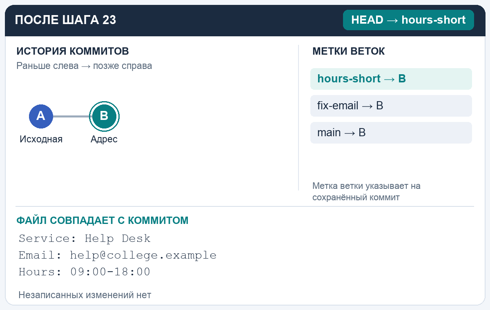
</td>
</tr>
</table>

### Шаг 24. Измените время окончания работы

<table>
<tr>
<td width="48%" valign="top">
<p><strong>Основная команда — введите в Git Bash:</strong></p>
<pre class="command"><code>printf &#x27;%s\n&#x27; &#x27;Service: Help Desk&#x27; &#x27;Email: help@college.example&#x27; &#x27;Hours: 09:00-17:00&#x27; &gt; support.txt</code></pre>
<div class="command-parts"><p><strong>Разбор команды по частям</strong></p><ul><li><code>printf</code> — Форматирует и выводит строки; здесь результат направляется в файл.</li><li><code>&#x27;%s\n&#x27;</code> — Строка формата в одинарных кавычках: %s подставляет очередной строковый аргумент, \n добавляет перевод строки. Формат повторяется для каждого переданного текста.</li><li><code>&#x27;Service: Help Desk&#x27;</code> — Один строковый аргумент — соответствующая строка карточки. Одинарные кавычки сохраняют пробелы внутри текста и сами в файл не попадают.</li><li><code>&#x27;Email: help@college.example&#x27;</code> — Один строковый аргумент — соответствующая строка карточки. Одинарные кавычки сохраняют пробелы внутри текста и сами в файл не попадают.</li><li><code>&#x27;Hours: 09:00-17:00&#x27;</code> — Один строковый аргумент — соответствующая строка карточки. Одинарные кавычки сохраняют пробелы внутри текста и сами в файл не попадают.</li><li><code>&gt;</code> — Оператор Git Bash: заменяет содержимое файла выводом команды; при отсутствии создаёт файл.</li><li><code>support.txt</code> — Файл, в который направляется вывод printf; расположен в текущей учебной папке.</li></ul></div>
<p>В рабочем файле график заменён на 09:00–17:00. Правильный адрес электронной почты сохранён.</p>
<p><strong>Как проверить результат</strong></p>
<p>Команда записи ничего не печатает. Чтобы увидеть, что теперь находится в файле, введите:</p>
<pre class="check-command"><code>cat support.txt</code></pre><div class="command-parts"><p><strong>Разбор команды по частям</strong></p><ul><li><code>cat</code> — Выводит содержимое указанного файла в терминал.</li><li><code>support.txt</code> — Имя читаемого файла карточки. Команда не изменяет файл.</li></ul></div>
<p><strong>Что должно быть в ответе — вводить этот текст не нужно:</strong></p><pre class="expected-output"><samp>Service: Help Desk
Email: help@college.example
Hours: 09:00-17:00</samp></pre>
<p>Сравните три строки с образцом. Если они совпадают, файл записан правильно; открывать его в редакторе не требуется.</p>

</td>
<td width="52%" valign="top">
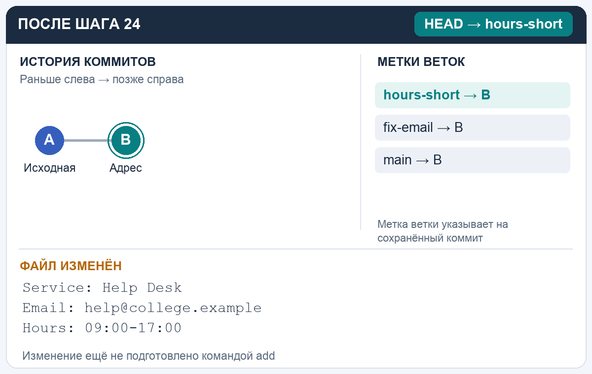
</td>
</tr>
</table>

### Шаг 25. Подготовьте сокращённый график

<table>
<tr>
<td width="48%" valign="top">
<p><strong>Основная команда — введите в Git Bash:</strong></p>
<pre class="command"><code>git add support.txt</code></pre>
<div class="command-parts"><p><strong>Разбор команды по частям</strong></p><ul><li><code>git</code> — Запускает систему контроля версий Git.</li><li><code>add</code> — Помещает выбранную версию файла в индекс; во время слияния также отмечает конфликт решённым.</li><li><code>support.txt</code> — Имя файла карточки в текущей папке; .txt — расширение текстового файла.</li></ul></div>
<p>Добавьте изменённый файл в индекс, чтобы сохранить именно эту версию графика.</p>
<p><strong>Как проверить результат</strong></p>
<p>После add обычно нет сообщения. Чтобы увидеть подготовленное изменение, введите:</p>
<pre class="check-command"><code>git status</code></pre><div class="command-parts"><p><strong>Разбор команды по частям</strong></p><ul><li><code>git</code> — Запускает систему контроля версий Git.</li><li><code>status</code> — Показывает текущую ветку, подготовленные и неподготовленные изменения, состояние слияния.</li></ul></div>
<p><strong>Что должно быть в ответе — вводить этот текст не нужно:</strong></p><pre class="expected-output"><samp>Changes to be committed:
  modified:   support.txt</samp></pre>
<p>Найдите файл именно под заголовком Changes to be committed. Это означает, что он подготовлен к коммиту. Отступы в вашем окне могут отличаться.</p>

</td>
<td width="52%" valign="top">
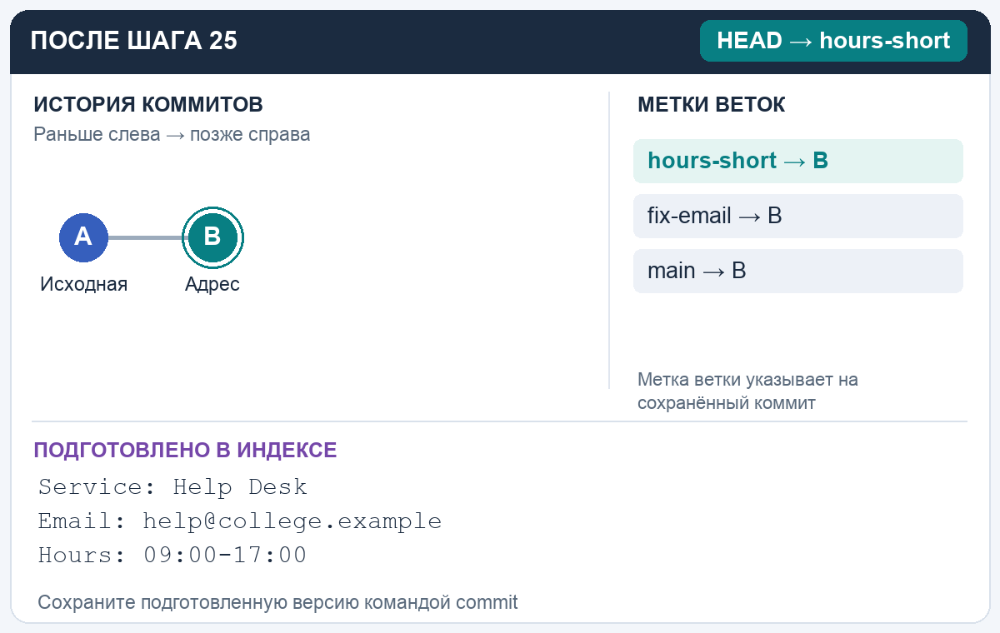
</td>
</tr>
</table>

### Шаг 26. Сохраните первую версию графика

<table>
<tr>
<td width="48%" valign="top">
<p><strong>Основная команда — введите в Git Bash:</strong></p>
<pre class="command"><code>git commit -m &quot;Set short working hours&quot;</code></pre>
<div class="command-parts"><p><strong>Разбор команды по частям</strong></p><ul><li><code>git</code> — Запускает систему контроля версий Git.</li><li><code>commit</code> — Создаёт коммит из подготовленного содержимого индекса.</li><li><code>-m</code> — Следующий аргумент — сообщение коммита; редактор сообщения не открывается.</li><li><code>&quot;Set short working hours&quot;</code> — Текст сообщения этого коммита. Пробелы находятся внутри двойных кавычек, поэтому весь текст передаётся одним аргументом; сами кавычки не сохраняются.</li></ul></div>
<p>Создан коммит C с графиком 09:00–17:00. Ветка hours-short указывает на C. Ветка main всё ещё на B.</p>
<p><strong>Как проверить результат</strong></p>
<p>Посмотрите ответ Git под выполненной командой commit и найдите в нём это сообщение. Дополнительную команду вводить не нужно.</p>

<p><strong>Что должно быть в ответе — вводить этот текст не нужно:</strong></p><pre class="expected-output"><samp>Set short working hours</samp></pre>
<p>Перед сообщением Git покажет имя ветки и идентификатор коммита. Идентификатор у вас будет свой; сравнивать его с буквами на схеме не нужно.</p>

</td>
<td width="52%" valign="top">
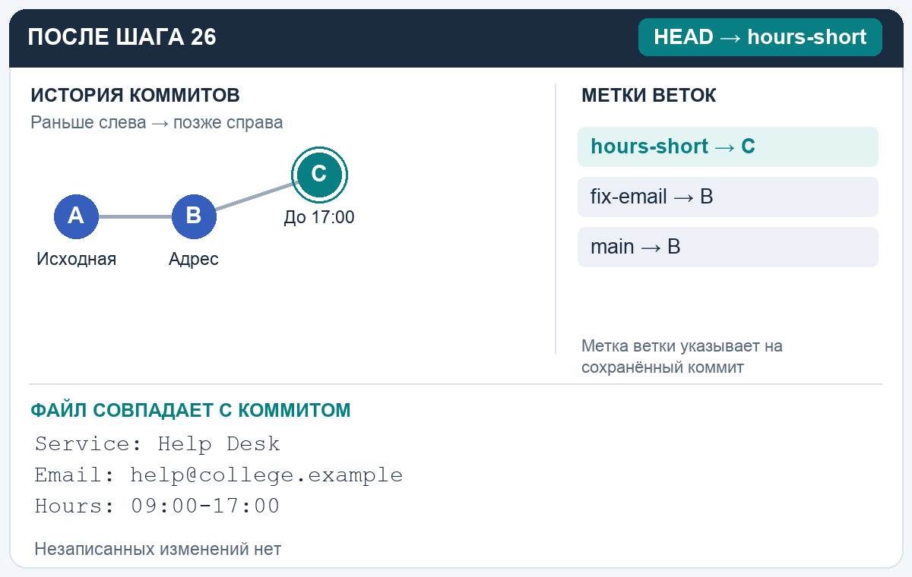
</td>
</tr>
</table>

### Шаг 27. Вернитесь в main перед второй доработкой

<table>
<tr>
<td width="48%" valign="top">
<p><strong>Основная команда — введите в Git Bash:</strong></p>
<pre class="command"><code>git switch main</code></pre>
<div class="command-parts"><p><strong>Разбор команды по частям</strong></p><ul><li><code>git</code> — Запускает систему контроля версий Git.</li><li><code>switch</code> — Переключает текущую ветку; с ключом -c сначала создаёт новую.</li><li><code>main</code> — Основная ветка учебного проекта. Это имя ветки, а не ключ; дефис внутри имени не создаёт отдельный параметр.</li></ul></div>
<p>Этот переход обязателен: вторая версия должна начаться с B, независимо от C. В файле снова график 09:00–18:00.</p>
<p><strong>Как проверить результат</strong></p>
<p>Чтобы точно узнать, какая ветка сейчас выбрана, введите:</p>
<pre class="check-command"><code>git branch --show-current</code></pre><div class="command-parts"><p><strong>Разбор команды по частям</strong></p><ul><li><code>git</code> — Запускает систему контроля версий Git.</li><li><code>branch</code> — Без ключей показывает список локальных веток.</li><li><code>--show-current</code> — Выводит только имя текущей ветки.</li></ul></div>
<p><strong>Что должно быть в ответе — вводить этот текст не нужно:</strong></p><pre class="expected-output"><samp>main</samp></pre>
<p>Ответ должен состоять из этого имени. Это имя текущей ветки, а не команда, которую нужно выполнить.</p>

</td>
<td width="52%" valign="top">
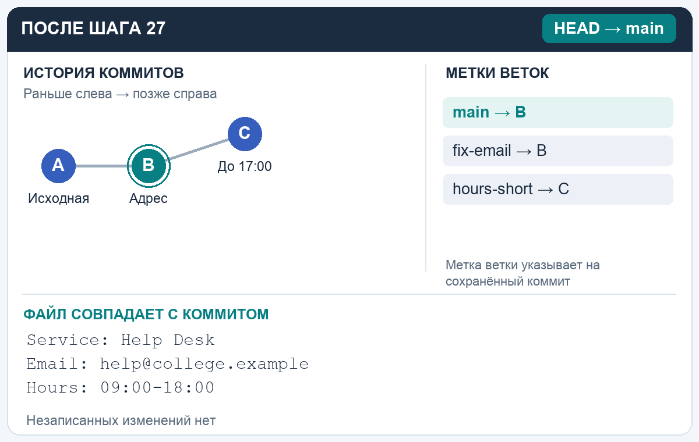
</td>
</tr>
</table>

### Шаг 28. Создайте ветку расширенного графика

<table>
<tr>
<td width="48%" valign="top">
<p><strong>Основная команда — введите в Git Bash:</strong></p>
<pre class="command"><code>git switch -c hours-long</code></pre>
<div class="command-parts"><p><strong>Разбор команды по частям</strong></p><ul><li><code>git</code> — Запускает систему контроля версий Git.</li><li><code>switch</code> — Переключает текущую ветку; с ключом -c сначала создаёт новую.</li><li><code>-c</code> — Создаёт новую ветку с именем из следующего аргумента и переключается в неё.</li><li><code>hours-long</code> — Ветка графика 08:00–20:00. Это имя ветки, а не ключ; дефис внутри имени не создаёт отдельный параметр.</li></ul></div>
<p>Ветка hours-long создаётся от B, а не от C. У двух доработок будет общая исходная версия, но разные продолжения.</p>
<p><strong>Как проверить результат</strong></p>
<p>Чтобы точно узнать, какая ветка сейчас выбрана, введите:</p>
<pre class="check-command"><code>git branch --show-current</code></pre><div class="command-parts"><p><strong>Разбор команды по частям</strong></p><ul><li><code>git</code> — Запускает систему контроля версий Git.</li><li><code>branch</code> — Без ключей показывает список локальных веток.</li><li><code>--show-current</code> — Выводит только имя текущей ветки.</li></ul></div>
<p><strong>Что должно быть в ответе — вводить этот текст не нужно:</strong></p><pre class="expected-output"><samp>hours-long</samp></pre>
<p>Ответ должен состоять из этого имени. Это имя текущей ветки, а не команда, которую нужно выполнить.</p>

</td>
<td width="52%" valign="top">
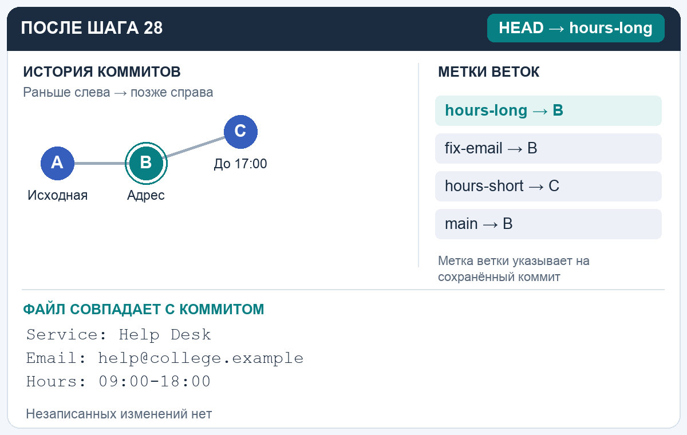
</td>
</tr>
</table>

### Шаг 29. Запишите расширенный график

<table>
<tr>
<td width="48%" valign="top">
<p><strong>Основная команда — введите в Git Bash:</strong></p>
<pre class="command"><code>printf &#x27;%s\n&#x27; &#x27;Service: Help Desk&#x27; &#x27;Email: help@college.example&#x27; &#x27;Hours: 08:00-20:00&#x27; &gt; support.txt</code></pre>
<div class="command-parts"><p><strong>Разбор команды по частям</strong></p><ul><li><code>printf</code> — Форматирует и выводит строки; здесь результат направляется в файл.</li><li><code>&#x27;%s\n&#x27;</code> — Строка формата в одинарных кавычках: %s подставляет очередной строковый аргумент, \n добавляет перевод строки. Формат повторяется для каждого переданного текста.</li><li><code>&#x27;Service: Help Desk&#x27;</code> — Один строковый аргумент — соответствующая строка карточки. Одинарные кавычки сохраняют пробелы внутри текста и сами в файл не попадают.</li><li><code>&#x27;Email: help@college.example&#x27;</code> — Один строковый аргумент — соответствующая строка карточки. Одинарные кавычки сохраняют пробелы внутри текста и сами в файл не попадают.</li><li><code>&#x27;Hours: 08:00-20:00&#x27;</code> — Один строковый аргумент — соответствующая строка карточки. Одинарные кавычки сохраняют пробелы внутри текста и сами в файл не попадают.</li><li><code>&gt;</code> — Оператор Git Bash: заменяет содержимое файла выводом команды; при отсутствии создаёт файл.</li><li><code>support.txt</code> — Файл, в который направляется вывод printf; расположен в текущей учебной папке.</li></ul></div>
<p>Вторая доработка меняет ту же строку Hours, но на 08:00–20:00. Именно различие этой строки позднее вызовет конфликт.</p>
<p><strong>Как проверить результат</strong></p>
<p>Команда записи ничего не печатает. Чтобы увидеть, что теперь находится в файле, введите:</p>
<pre class="check-command"><code>cat support.txt</code></pre><div class="command-parts"><p><strong>Разбор команды по частям</strong></p><ul><li><code>cat</code> — Выводит содержимое указанного файла в терминал.</li><li><code>support.txt</code> — Имя читаемого файла карточки. Команда не изменяет файл.</li></ul></div>
<p><strong>Что должно быть в ответе — вводить этот текст не нужно:</strong></p><pre class="expected-output"><samp>Service: Help Desk
Email: help@college.example
Hours: 08:00-20:00</samp></pre>
<p>Сравните три строки с образцом. Если они совпадают, файл записан правильно; открывать его в редакторе не требуется.</p>

</td>
<td width="52%" valign="top">
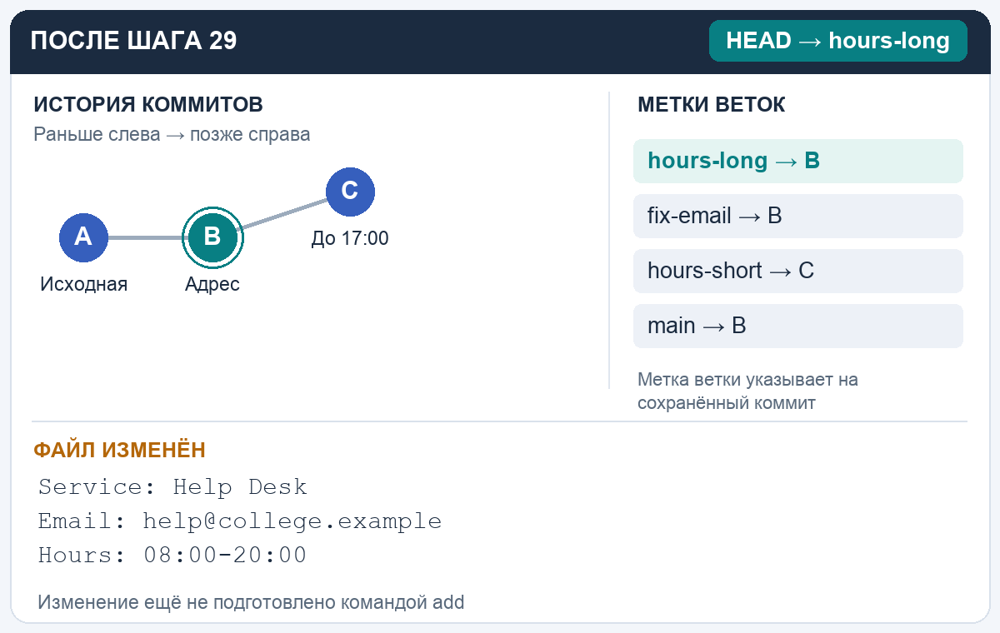
</td>
</tr>
</table>

### Шаг 30. Подготовьте расширенный график

<table>
<tr>
<td width="48%" valign="top">
<p><strong>Основная команда — введите в Git Bash:</strong></p>
<pre class="command"><code>git add support.txt</code></pre>
<div class="command-parts"><p><strong>Разбор команды по частям</strong></p><ul><li><code>git</code> — Запускает систему контроля версий Git.</li><li><code>add</code> — Помещает выбранную версию файла в индекс; во время слияния также отмечает конфликт решённым.</li><li><code>support.txt</code> — Имя файла карточки в текущей папке; .txt — расширение текстового файла.</li></ul></div>
<p>В индекс помещается версия файла с графиком 08:00–20:00.</p>
<p><strong>Как проверить результат</strong></p>
<p>После add обычно нет сообщения. Чтобы увидеть подготовленное изменение, введите:</p>
<pre class="check-command"><code>git status</code></pre><div class="command-parts"><p><strong>Разбор команды по частям</strong></p><ul><li><code>git</code> — Запускает систему контроля версий Git.</li><li><code>status</code> — Показывает текущую ветку, подготовленные и неподготовленные изменения, состояние слияния.</li></ul></div>
<p><strong>Что должно быть в ответе — вводить этот текст не нужно:</strong></p><pre class="expected-output"><samp>Changes to be committed:
  modified:   support.txt</samp></pre>
<p>Найдите файл именно под заголовком Changes to be committed. Это означает, что он подготовлен к коммиту. Отступы в вашем окне могут отличаться.</p>

</td>
<td width="52%" valign="top">
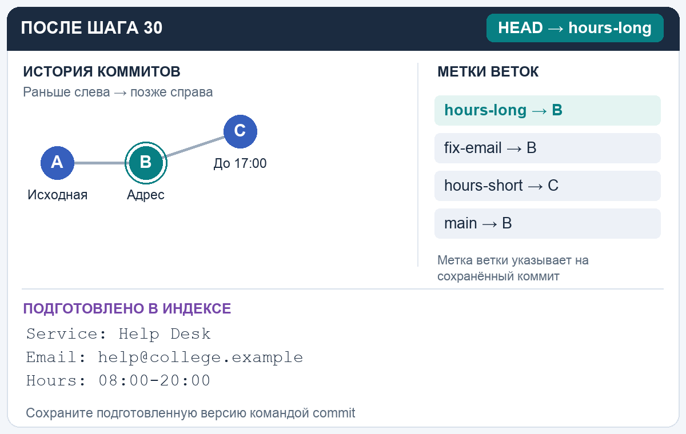
</td>
</tr>
</table>

### Шаг 31. Сохраните вторую версию графика

<table>
<tr>
<td width="48%" valign="top">
<p><strong>Основная команда — введите в Git Bash:</strong></p>
<pre class="command"><code>git commit -m &quot;Set long working hours&quot;</code></pre>
<div class="command-parts"><p><strong>Разбор команды по частям</strong></p><ul><li><code>git</code> — Запускает систему контроля версий Git.</li><li><code>commit</code> — Создаёт коммит из подготовленного содержимого индекса.</li><li><code>-m</code> — Следующий аргумент — сообщение коммита; редактор сообщения не открывается.</li><li><code>&quot;Set long working hours&quot;</code> — Текст сообщения этого коммита. Пробелы находятся внутри двойных кавычек, поэтому весь текст передаётся одним аргументом; сами кавычки не сохраняются.</li></ul></div>
<p>Создан коммит D. Теперь от B расходятся две линии: C в hours-short и D в hours-long. Ни один из этих коммитов не содержит другой.</p>
<p><strong>Как проверить результат</strong></p>
<p>Посмотрите ответ Git под выполненной командой commit и найдите в нём это сообщение. Дополнительную команду вводить не нужно.</p>

<p><strong>Что должно быть в ответе — вводить этот текст не нужно:</strong></p><pre class="expected-output"><samp>Set long working hours</samp></pre>
<p>Перед сообщением Git покажет имя ветки и идентификатор коммита. Идентификатор у вас будет свой; сравнивать его с буквами на схеме не нужно.</p>

</td>
<td width="52%" valign="top">
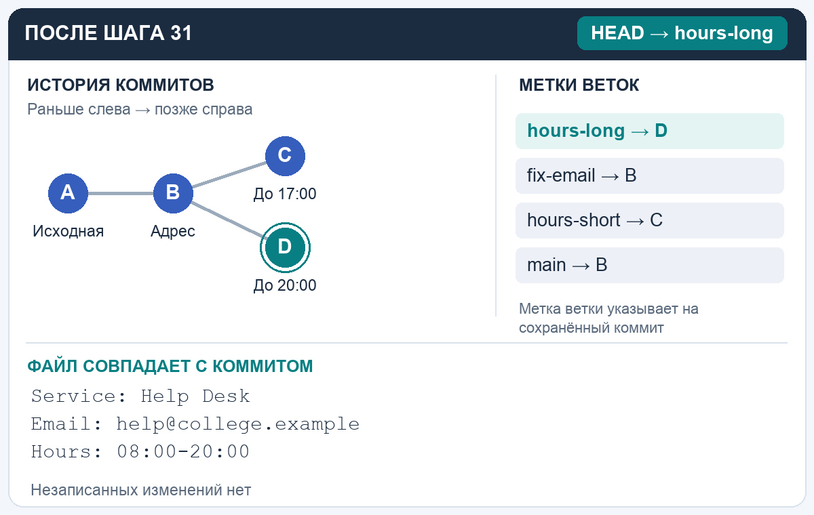
</td>
</tr>
</table>


## 5. Слияние и разрешение конфликта

### Шаг 32. Перейдите в основную ветку для слияния

<table>
<tr>
<td width="48%" valign="top">
<p><strong>Основная команда — введите в Git Bash:</strong></p>
<pre class="command"><code>git switch main</code></pre>
<div class="command-parts"><p><strong>Разбор команды по частям</strong></p><ul><li><code>git</code> — Запускает систему контроля версий Git.</li><li><code>switch</code> — Переключает текущую ветку; с ключом -c сначала создаёт новую.</li><li><code>main</code> — Основная ветка учебного проекта. Это имя ветки, а не ключ; дефис внутри имени не создаёт отдельный параметр.</li></ul></div>
<p>Результат объединения должен попасть в main, поэтому сначала выберите её. Пока main находится на B.</p>
<p><strong>Как проверить результат</strong></p>
<p>Чтобы точно узнать, какая ветка сейчас выбрана, введите:</p>
<pre class="check-command"><code>git branch --show-current</code></pre><div class="command-parts"><p><strong>Разбор команды по частям</strong></p><ul><li><code>git</code> — Запускает систему контроля версий Git.</li><li><code>branch</code> — Без ключей показывает список локальных веток.</li><li><code>--show-current</code> — Выводит только имя текущей ветки.</li></ul></div>
<p><strong>Что должно быть в ответе — вводить этот текст не нужно:</strong></p><pre class="expected-output"><samp>main</samp></pre>
<p>Ответ должен состоять из этого имени. Это имя текущей ветки, а не команда, которую нужно выполнить.</p>

</td>
<td width="52%" valign="top">
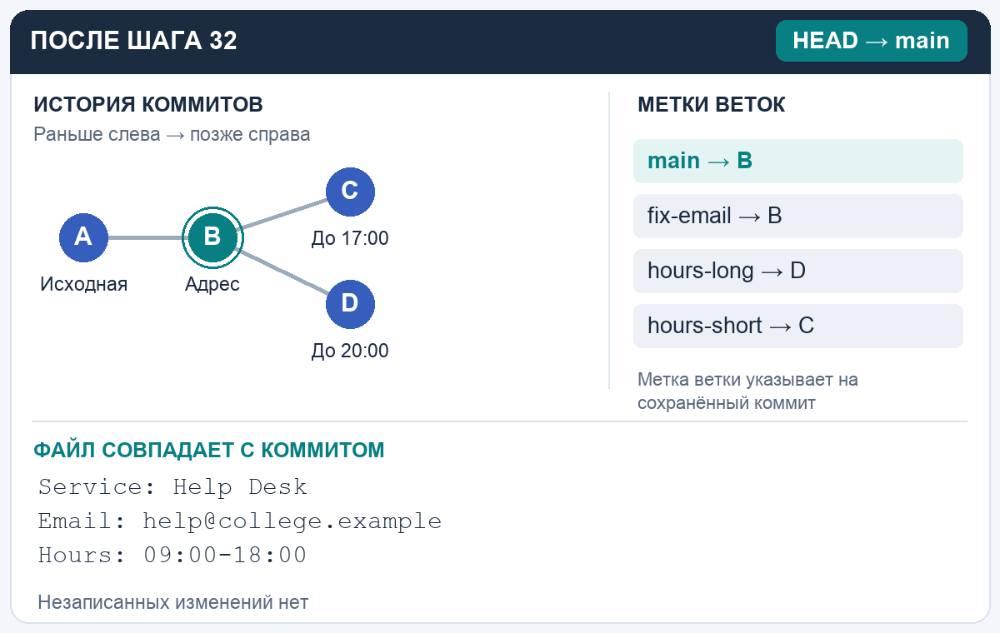
</td>
</tr>
</table>

### Шаг 33. Примите первую доработку

<table>
<tr>
<td width="48%" valign="top">
<p><strong>Основная команда — введите в Git Bash:</strong></p>
<pre class="command"><code>git merge --ff-only hours-short</code></pre>
<div class="command-parts"><p><strong>Разбор команды по частям</strong></p><ul><li><code>git</code> — Запускает систему контроля версий Git.</li><li><code>merge</code> — Объединяет указанную ветку с текущей.</li><li><code>--ff-only</code> — Разрешает слияние только перемещением текущей ветки вперёд по существующей истории. При расхождении линий операция будет отклонена.</li><li><code>hours-short</code> — Ветка графика 09:00–17:00. Это имя ветки, а не ключ; дефис внутри имени не создаёт отдельный параметр.</li></ul></div>
<p>Git передвигает main с B на C. В основной ветке теперь график 09:00–17:00; hours-long остаётся на D.</p>
<p><strong>Как проверить результат</strong></p>
<p>Посмотрите ответ Git сразу под командой merge. Дополнительную команду вводить не нужно.</p>

<p><strong>Что должно быть в ответе — вводить этот текст не нужно:</strong></p><pre class="expected-output"><samp>Fast-forward</samp></pre>
<p>Найдите эту строку среди остальных сообщений. Она означает, что текущая ветка передвинулась на уже существующий коммит, как на схеме справа.</p>

</td>
<td width="52%" valign="top">
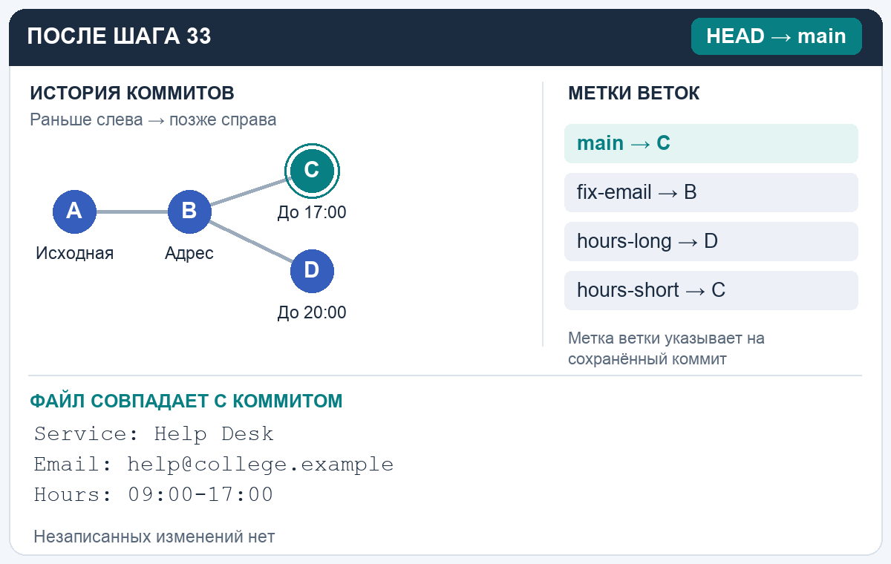
</td>
</tr>
</table>

### Шаг 34. Попробуйте добавить вторую доработку

<table>
<tr>
<td width="48%" valign="top">
<p><strong>Основная команда — введите в Git Bash:</strong></p>
<pre class="command"><code>git merge --no-ff --no-edit hours-long</code></pre>
<div class="command-parts"><p><strong>Разбор команды по частям</strong></p><ul><li><code>git</code> — Запускает систему контроля версий Git.</li><li><code>merge</code> — Объединяет указанную ветку с текущей.</li><li><code>--no-ff</code> — При слиянии требует отдельный коммит слияния вместо fast-forward; при конфликте сначала нужно разрешить конфликт.</li><li><code>--no-edit</code> — Принимает автоматически предложенное сообщение слияния без открытия редактора. Сам конфликт этот ключ не разрешает.</li><li><code>hours-long</code> — Ветка графика 08:00–20:00. Это имя ветки, а не ключ; дефис внутри имени не создаёт отдельный параметр.</li></ul></div>
<p>Теперь две линии меняют одну строку по-разному. Git останавливает слияние, чтобы вы выбрали итоговый текст. --no-ff допускает отдельный коммит слияния, --no-edit не открывает редактор сообщения.</p>
<p><strong>Как проверить результат</strong></p>
<p>Посмотрите ответ Git под командой merge. Дополнительную команду пока вводить не нужно.</p>

<p><strong>Что должно быть в ответе — вводить этот текст не нужно:</strong></p><pre class="expected-output"><samp>CONFLICT (content): Merge conflict in support.txt
Automatic merge failed; fix conflicts and then commit the result.</samp></pre>
<p>Для этого шага это правильный результат. Не повторяйте merge: переходите к шагу 35, где указана следующая команда.</p>

</td>
<td width="52%" valign="top">

</td>
</tr>
</table>

### Шаг 35. Определите конфликтный файл

<table>
<tr>
<td width="48%" valign="top">
<p><strong>Основная команда — введите в Git Bash:</strong></p>
<pre class="command"><code>git status</code></pre>
<div class="command-parts"><p><strong>Разбор команды по частям</strong></p><ul><li><code>git</code> — Запускает систему контроля версий Git.</li><li><code>status</code> — Показывает текущую ветку, подготовленные и неподготовленные изменения, состояние слияния.</li></ul></div>
<p>status показывает состояние репозитория. Unmerged paths и both modified: support.txt означают, что слияние ещё не завершено.</p>
<p><strong>Как проверить результат</strong></p>
<p>Команда status уже вывела состояние. Найдите в её ответе этот раздел; дополнительную команду вводить не нужно.</p>

<p><strong>Что должно быть в ответе — вводить этот текст не нужно:</strong></p><pre class="expected-output"><samp>Unmerged paths:
  both modified:   support.txt</samp></pre>
<p>Файл указан среди неразрешённых конфликтов. Это ожидаемое состояние; переходите к просмотру файла на шаге 36.</p>

</td>
<td width="52%" valign="top">
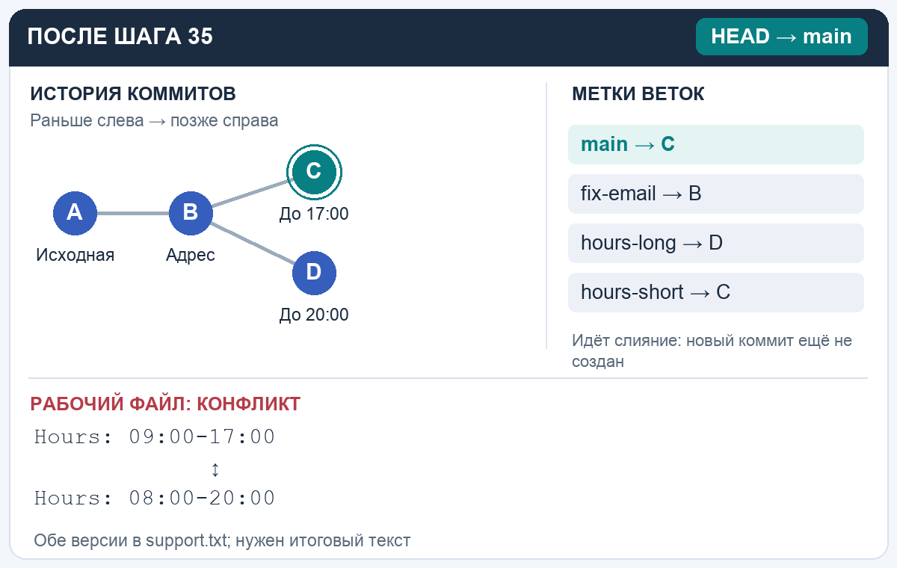
</td>
</tr>
</table>

### Шаг 36. Посмотрите обе конфликтующие версии

<table>
<tr>
<td width="48%" valign="top">
<p><strong>Основная команда — введите в Git Bash:</strong></p>
<pre class="command"><code>cat support.txt</code></pre>
<div class="command-parts"><p><strong>Разбор команды по частям</strong></p><ul><li><code>cat</code> — Выводит содержимое указанного файла в терминал.</li><li><code>support.txt</code> — Имя читаемого файла карточки. Команда не изменяет файл.</li></ul></div>
<p>Между &lt;&lt;&lt;&lt;&lt;&lt;&lt; HEAD и ======= находится версия текущей main; между ======= и &gt;&gt;&gt;&gt;&gt;&gt;&gt; hours-long — версия присоединяемой ветки.</p>
<p><strong>Как проверить результат</strong></p>
<p>Команда cat уже показала файл в терминале. Посмотрите её ответ; повторно вводить команду не нужно.</p>

<p><strong>Что должно быть в ответе — вводить этот текст не нужно:</strong></p><pre class="expected-output"><samp>&lt;&lt;&lt;&lt;&lt;&lt;&lt; HEAD
Hours: 09:00-17:00
=======
Hours: 08:00-20:00
&gt;&gt;&gt;&gt;&gt;&gt;&gt; hours-long</samp></pre>
<p>Это конфликтный фрагмент уже выведенного файла. Перед ним остаются строки Service и Email. Сейчас только прочитайте обе версии; изменение файла выполняется на следующем шаге.</p>

</td>
<td width="52%" valign="top">

</td>
</tr>
</table>

### Шаг 37. Запишите согласованное решение

<table>
<tr>
<td width="48%" valign="top">
<p><strong>Основная команда — введите в Git Bash:</strong></p>
<pre class="command"><code>printf &#x27;%s\n&#x27; &#x27;Service: Help Desk&#x27; &#x27;Email: help@college.example&#x27; &#x27;Hours: 09:00-19:00&#x27; &gt; support.txt</code></pre>
<div class="command-parts"><p><strong>Разбор команды по частям</strong></p><ul><li><code>printf</code> — Форматирует и выводит строки; здесь результат направляется в файл.</li><li><code>&#x27;%s\n&#x27;</code> — Строка формата в одинарных кавычках: %s подставляет очередной строковый аргумент, \n добавляет перевод строки. Формат повторяется для каждого переданного текста.</li><li><code>&#x27;Service: Help Desk&#x27;</code> — Один строковый аргумент — соответствующая строка карточки. Одинарные кавычки сохраняют пробелы внутри текста и сами в файл не попадают.</li><li><code>&#x27;Email: help@college.example&#x27;</code> — Один строковый аргумент — соответствующая строка карточки. Одинарные кавычки сохраняют пробелы внутри текста и сами в файл не попадают.</li><li><code>&#x27;Hours: 09:00-19:00&#x27;</code> — Один строковый аргумент — соответствующая строка карточки. Одинарные кавычки сохраняют пробелы внутри текста и сами в файл не попадают.</li><li><code>&gt;</code> — Оператор Git Bash: заменяет содержимое файла выводом команды; при отсутствии создаёт файл.</li><li><code>support.txt</code> — Файл, в который направляется вывод printf; расположен в текущей учебной папке.</li></ul></div>
<p>По условию руководитель согласовал график 09:00–19:00. Команда заменяет небольшой файл итоговым содержимым и убирает разделители. Решение может отличаться от обеих исходных версий.</p>
<p><strong>Как проверить результат</strong></p>
<p>Команда записи ничего не печатает. Чтобы увидеть, что теперь находится в файле, введите:</p>
<pre class="check-command"><code>cat support.txt</code></pre><div class="command-parts"><p><strong>Разбор команды по частям</strong></p><ul><li><code>cat</code> — Выводит содержимое указанного файла в терминал.</li><li><code>support.txt</code> — Имя читаемого файла карточки. Команда не изменяет файл.</li></ul></div>
<p><strong>Что должно быть в ответе — вводить этот текст не нужно:</strong></p><pre class="expected-output"><samp>Service: Help Desk
Email: help@college.example
Hours: 09:00-19:00</samp></pre>
<p>Сравните все три строки. Разделителей &lt;&lt;&lt;&lt;&lt;&lt;&lt;, ======= и &gt;&gt;&gt;&gt;&gt;&gt;&gt; быть не должно. Отметить решение в Git нужно будет на шаге 39.</p>

</td>
<td width="52%" valign="top">
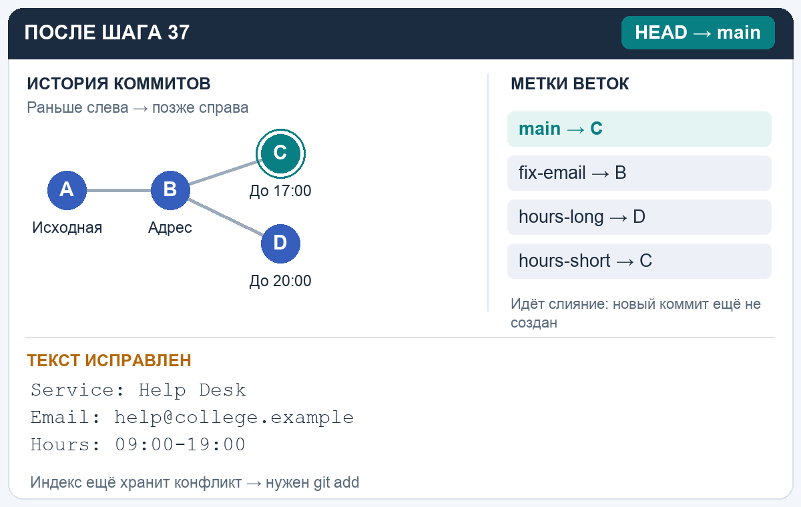
</td>
</tr>
</table>

### Шаг 38. Проверьте удаление разделителей

<table>
<tr>
<td width="48%" valign="top">
<p><strong>Основная команда — введите в Git Bash:</strong></p>
<pre class="command"><code>git diff --check</code></pre>
<div class="command-parts"><p><strong>Разбор команды по частям</strong></p><ul><li><code>git</code> — Запускает систему контроля версий Git.</li><li><code>diff</code> — Показывает различия; без дополнительных ключей сравнивает рабочие файлы с индексом.</li><li><code>--check</code> — Проверяет изменения на оставленные разделители конфликта и ошибки пробелов; не проверяет смысл содержимого.</li></ul></div>
<p>Команда обнаруживает оставленные разделители конфликта и ошибки пробелов. Она проверяет оформление изменений, но не смысл выбранного графика.</p>
<p><strong>Как проверить результат</strong></p>
<p>Посмотрите, что появилось после команды. Если Git Bash сразу показал новую строку для ввода и не напечатал сообщений, проверка прошла.</p>


<p>Дополнительную команду вводить не нужно. Если есть leftover conflict marker, повторите шаг 37, затем эту проверку.</p>

</td>
<td width="52%" valign="top">
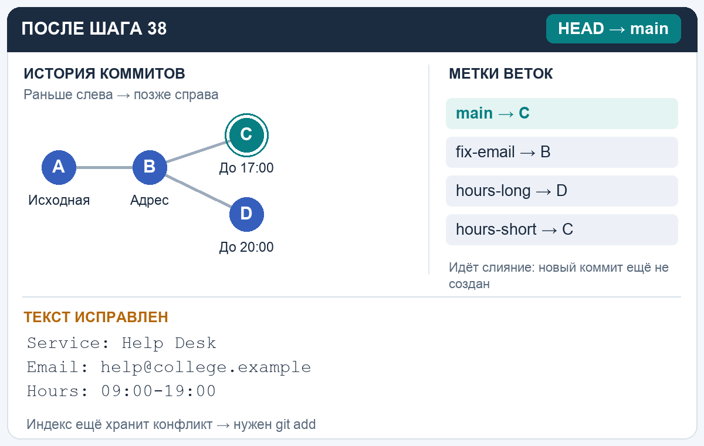
</td>
</tr>
</table>

### Шаг 39. Отметьте конфликт решённым

<table>
<tr>
<td width="48%" valign="top">
<p><strong>Основная команда — введите в Git Bash:</strong></p>
<pre class="command"><code>git add support.txt</code></pre>
<div class="command-parts"><p><strong>Разбор команды по частям</strong></p><ul><li><code>git</code> — Запускает систему контроля версий Git.</li><li><code>add</code> — Помещает выбранную версию файла в индекс; во время слияния также отмечает конфликт решённым.</li><li><code>support.txt</code> — Имя файла карточки в текущей папке; .txt — расширение текстового файла.</li></ul></div>
<p>При незавершённом слиянии add не только готовит файл к коммиту, но и отмечает конфликт в нём как решённый. Слияние ещё нужно завершить коммитом.</p>
<p><strong>Как проверить результат</strong></p>
<p>После add обычно нет сообщения. Чтобы увидеть подготовленное изменение, введите:</p>
<pre class="check-command"><code>git status</code></pre><div class="command-parts"><p><strong>Разбор команды по частям</strong></p><ul><li><code>git</code> — Запускает систему контроля версий Git.</li><li><code>status</code> — Показывает текущую ветку, подготовленные и неподготовленные изменения, состояние слияния.</li></ul></div>
<p><strong>Что должно быть в ответе — вводить этот текст не нужно:</strong></p><pre class="expected-output"><samp>All conflicts fixed but you are still merging.

Changes to be committed:
  modified:   support.txt</samp></pre>
<p>Фраза All conflicts fixed подтверждает, что конфликт отмечен решённым. Само слияние завершится только коммитом на шаге 40.</p>

</td>
<td width="52%" valign="top">
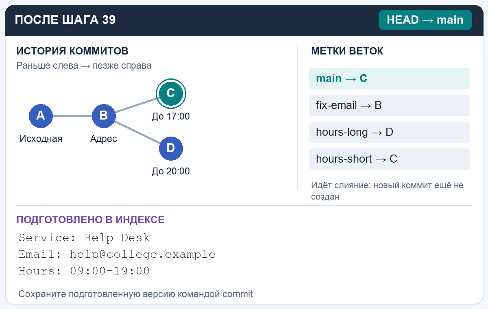
</td>
</tr>
</table>

### Шаг 40. Завершите слияние

<table>
<tr>
<td width="48%" valign="top">
<p><strong>Основная команда — введите в Git Bash:</strong></p>
<pre class="command"><code>git commit -m &quot;Resolve working hours conflict&quot;</code></pre>
<div class="command-parts"><p><strong>Разбор команды по частям</strong></p><ul><li><code>git</code> — Запускает систему контроля версий Git.</li><li><code>commit</code> — Создаёт коммит из подготовленного содержимого индекса.</li><li><code>-m</code> — Следующий аргумент — сообщение коммита; редактор сообщения не открывается.</li><li><code>&quot;Resolve working hours conflict&quot;</code> — Текст сообщения этого коммита. Пробелы находятся внутри двойных кавычек, поэтому весь текст передаётся одним аргументом; сами кавычки не сохраняются.</li></ul></div>
<p>Создан коммит E с двумя родителями — C и D. Он сохраняет итоговый график и связывает обе линии истории. main переместилась на E.</p>
<p><strong>Как проверить результат</strong></p>
<p>Посмотрите ответ Git под выполненной командой commit и найдите в нём это сообщение. Дополнительную команду вводить не нужно.</p>

<p><strong>Что должно быть в ответе — вводить этот текст не нужно:</strong></p><pre class="expected-output"><samp>Resolve working hours conflict</samp></pre>
<p>Перед сообщением Git покажет имя ветки и идентификатор коммита. Идентификатор у вас будет свой; сравнивать его с буквами на схеме не нужно.</p>

</td>
<td width="52%" valign="top">

</td>
</tr>
</table>


## 6. Проверка результата

### Шаг 41. Просмотрите историю всех веток

<table>
<tr>
<td width="48%" valign="top">
<p><strong>Основная команда — введите в Git Bash:</strong></p>
<pre class="command"><code>git --no-pager log --oneline --graph --all --decorate</code></pre>
<div class="command-parts"><p><strong>Разбор команды по частям</strong></p><ul><li><code>git</code> — Запускает систему контроля версий Git.</li><li><code>--no-pager</code> — Общий ключ Git: выводит ответ прямо в терминал, без отдельного просмотрщика.</li><li><code>log</code> — Показывает историю коммитов.</li><li><code>--oneline</code> — Показывает каждый коммит коротко: идентификатор и первая строка сообщения.</li><li><code>--graph</code> — Добавляет к истории текстовые линии ветвления и слияния.</li><li><code>--all</code> — В команде log включает коммиты, достижимые из всех ссылок, в том числе всех локальных веток.</li><li><code>--decorate</code> — Добавляет к записям имена веток и другие метки, например HEAD -&gt; main.</li></ul></div>
<p>--oneline сокращает записи; --graph рисует линии; --all показывает все ветки; --decorate добавляет их имена. --no-pager оставляет вывод в терминале.</p>
<p><strong>Как проверить результат</strong></p>
<p>Команда log уже вывела историю. Найдите пять записей о коммитах с указанными сообщениями. Дополнительную команду вводить не нужно.</p>

<p><strong>Что должно быть в ответе — вводить этот текст не нужно:</strong></p><pre class="expected-output"><samp>Resolve working hours conflict
Set long working hours
Set short working hours
Fix support email
Initial support card</samp></pre>
<p>У верхнего коммита должна быть метка HEAD -&gt; main. Две записи Set … могут идти в другом порядке; идентификаторы коммитов тоже будут своими.</p>

</td>
<td width="52%" valign="top">
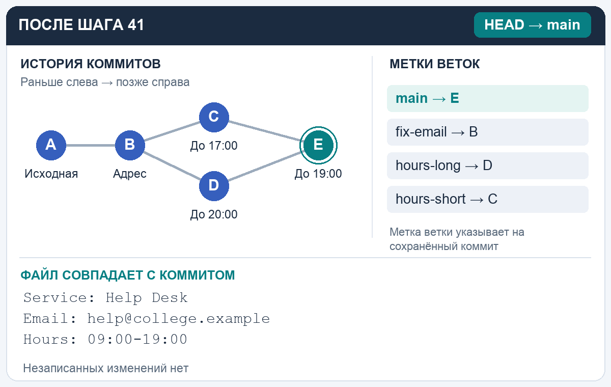
</td>
</tr>
</table>

### Шаг 42. Проверьте итоговый файл

<table>
<tr>
<td width="48%" valign="top">
<p><strong>Основная команда — введите в Git Bash:</strong></p>
<pre class="command"><code>cat support.txt</code></pre>
<div class="command-parts"><p><strong>Разбор команды по частям</strong></p><ul><li><code>cat</code> — Выводит содержимое указанного файла в терминал.</li><li><code>support.txt</code> — Имя читаемого файла карточки. Команда не изменяет файл.</li></ul></div>
<p>Проверьте результат объединения: правильный адрес, согласованный график и отсутствие разделителей конфликта.</p>
<p><strong>Как проверить результат</strong></p>
<p>Команда cat уже показала файл в терминале. Посмотрите её ответ; повторно вводить команду не нужно.</p>

<p><strong>Что должно быть в ответе — вводить этот текст не нужно:</strong></p><pre class="expected-output"><samp>Service: Help Desk
Email: help@college.example
Hours: 09:00-19:00</samp></pre>
<p>Сравните уже выведенные строки с образцом. Дополнительных действий на этом шаге нет.</p>

</td>
<td width="52%" valign="top">
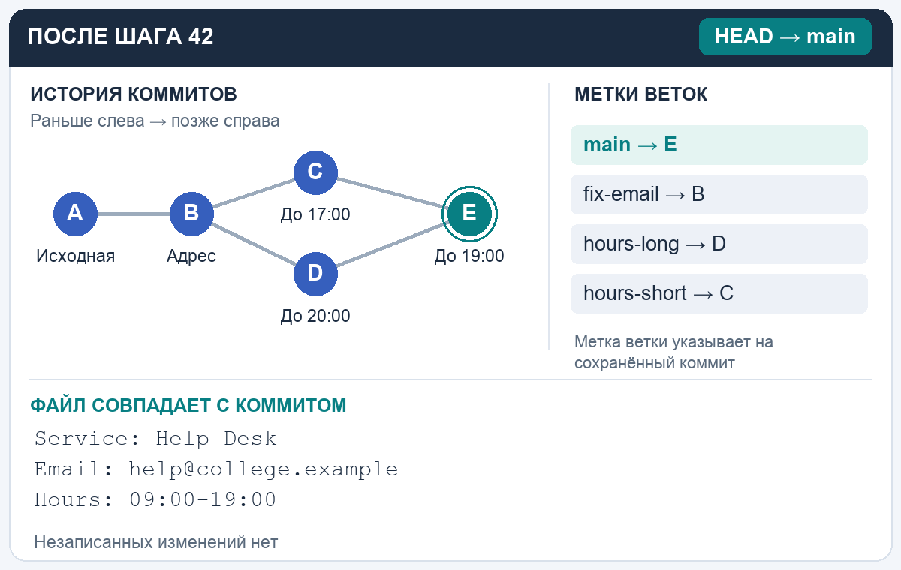
</td>
</tr>
</table>

### Шаг 43. Проверьте список веток

<table>
<tr>
<td width="48%" valign="top">
<p><strong>Основная команда — введите в Git Bash:</strong></p>
<pre class="command"><code>git branch</code></pre>
<div class="command-parts"><p><strong>Разбор команды по частям</strong></p><ul><li><code>git</code> — Запускает систему контроля версий Git.</li><li><code>branch</code> — Без ключей показывает список локальных веток.</li></ul></div>
<p>branch без параметров показывает локальные ветки. Звёздочка отмечает текущую. После слияния исходные ветки остаются в репозитории.</p>
<p><strong>Как проверить результат</strong></p>
<p>Команда branch уже показала список. Сравните четыре имени и положение звёздочки. Дополнительную команду вводить не нужно.</p>

<p><strong>Что должно быть в ответе — вводить этот текст не нужно:</strong></p><pre class="expected-output"><samp>  fix-email
  hours-long
  hours-short
* main</samp></pre>
<p>Звёздочка должна стоять перед main: эта ветка сейчас выбрана.</p>

</td>
<td width="52%" valign="top">

</td>
</tr>
</table>

### Шаг 44. Убедитесь, что работа сохранена

<table>
<tr>
<td width="48%" valign="top">
<p><strong>Основная команда — введите в Git Bash:</strong></p>
<pre class="command"><code>git status</code></pre>
<div class="command-parts"><p><strong>Разбор команды по частям</strong></p><ul><li><code>git</code> — Запускает систему контроля версий Git.</li><li><code>status</code> — Показывает текущую ветку, подготовленные и неподготовленные изменения, состояние слияния.</li></ul></div>
<p>Финальная проверка подтверждает, что вы на main и незаписанных изменений не осталось.</p>
<p><strong>Как проверить результат</strong></p>
<p>В ответе уже выполненной команды status найдите эти две строки. Дополнительную команду вводить не нужно.</p>

<p><strong>Что должно быть в ответе — вводить этот текст не нужно:</strong></p><pre class="expected-output"><samp>On branch main
nothing to commit, working tree clean</samp></pre>
<p>Они подтверждают, что выбрана main и все изменения сохранены. Основное задание закончено.</p>

</td>
<td width="52%" valign="top">

</td>
</tr>
</table>

## Каким должен быть результат

В текущей ветке `main` находится карточка:

```text
Service: Help Desk
Email: help@college.example
Hours: 09:00-19:00
```

В истории — **пять коммитов**. Последний имеет двух родителей. Сохраняются четыре ветки: `main` → E, `fix-email` → B, `hours-short` → C, `hours-long` → D. Это нормально: слияние не удаляет исходные ветки автоматически. Итоговый статус — `working tree clean`.

Для сдачи сохраните два скриншота: историю из шага 41 и итоговый файл со статусом из шагов 42–44. Если нужно передать проект, сохраните всю папку `git-branches-01`, включая скрытую папку `.git`: именно в ней находится история. Папка создана в профиле пользователя; её можно открыть из Git Bash командой `explorer.exe .`.

<div class="command-parts"><p><strong>Разбор команды по частям</strong></p><ul><li><code>explorer.exe</code> — Запускает Проводник Windows.</li><li><code>.</code> — Текущая папка терминала; именно её откроет Проводник.</li></ul></div>

## Самостоятельное продолжение

Создайте от итоговой `main` ветку `add-channel`. Добавьте в конец карточки строку `Channel: Email`, сохраните изменение отдельным коммитом и вернитесь в `main`. После возврата выполните в Git Bash `cat support.txt`: строки `Channel: Email` пока быть не должно. Затем объедините ветку с `main` и снова выполните `cat support.txt`: теперь новая строка должна появиться. Используйте уже знакомые команды; для добавления строки в конец файла в Git Bash подходит `printf '%s\n' 'Channel: Email' >> support.txt`. Здесь **два** знака `>>` добавляют строку, сохраняя остальной файл. Это отдельное упражнение: после него коммитов будет больше пяти.

<p><strong>Команда добавления строки для самостоятельного продолжения:</strong></p><pre class="service-command"><code>printf &#x27;%s\n&#x27; &#x27;Channel: Email&#x27; &gt;&gt; support.txt</code></pre><div class="command-parts"><p><strong>Разбор команды по частям</strong></p><ul><li><code>printf</code> — Форматирует и выводит строки; здесь результат направляется в файл.</li><li><code>&#x27;%s\n&#x27;</code> — Строка формата в одинарных кавычках: %s подставляет очередной строковый аргумент, \n добавляет перевод строки. Формат повторяется для каждого переданного текста.</li><li><code>&#x27;Channel: Email&#x27;</code> — Один строковый аргумент — соответствующая строка карточки. Одинарные кавычки сохраняют пробелы внутри текста и сами в файл не попадают.</li><li><code>&gt;&gt;</code> — Оператор Git Bash: добавляет вывод в конец файла, сохраняя прежнее содержимое.</li><li><code>support.txt</code> — Файл, в который направляется вывод printf; расположен в текущей учебной папке.</li></ul></div>

## Если результат отличается

**В Git Bash видно приглашение `>` вместо обычной строки ввода.** Команда не закончена: обычно не закрыта кавычка. Нажмите **Ctrl+C**, затем вставьте всю команду шага заново. Не путайте это приглашение с символом `>` внутри команды записи файла.

**`File exists` при создании папки.** Используйте новое имя, например `git-branches-02`, в командах `mkdir` и следующей `cd`. Остальные команды менять не нужно. Старую учебную папку удалять не требуется.

**`No such file or directory` при `cd`.** Папка не создана либо имя введено иначе. Повторите создание папки с новым именем и вход в неё. После ошибки `cd` не выполняйте `git init`, пока не окажетесь в нужной папке.

**`not a git repository`.** Терминал открыт вне проекта. Если вы уже создали его по инструкции, выполните `cd ~/git-branches-01` — или подставьте выбранное вами имя. Если `.git` ещё не создавалась, вернитесь к шагу 5. Не создавайте репозиторий в случайной папке.

**`Author identity unknown` или `Please tell me who you are`.** В папке проекта повторите шаги 6–7, затем только неудавшийся `git commit`. Повторно создавать ветку или файл не нужно.

**`gpg failed to sign the data`.** Повторите шаг 8 в учебном репозитории и повторите только неудавшийся коммит.

**`switch is not a git command` или `unknown switch b` у `init`.** Установлен слишком старый Git. Для единообразного выполнения нужен Git for Windows 2.28 или новее. Остановитесь до обновления; эта ошибка не исправляется входом в GitHub.

**`a branch named … already exists`.** Не повторяйте шаг создания ветки вслепую. В том же окне Git Bash выполните `git branch`, затем `git status`. В списке веток звёздочка отмечает текущую. Сопоставьте состояние со схемой. Если потеряли последовательность, начните в новой папке со шага 2 — существующая работа сохранится.

**`Your local changes … would be overwritten by checkout`.** Остались незаписанные изменения. Выполните в Git Bash `git status`, вернитесь к предыдущим шагам `add` и `commit` и сохраните предусмотренную ими доработку. После этого повторите переключение. Не применяйте принудительное переключение или `reset --hard`.

**`nothing to commit, working tree clean` на шаге коммита.** Возможно, этот коммит уже выполнен или файл не изменён. Сверьте содержимое `cat support.txt` и историю `git --no-pager log --oneline --all --decorate`. Если нужная запись уже есть, повторять коммит не нужно.

**`Already up to date` вместо ожидаемого слияния.** Возможно, слияние уже выполнялось. Сравните историю со схемой. Если на этапе конфликта его нет, проверьте, что обе ветки графика были созданы от B и получили разные изменения одной строки; при потерянной последовательности начните в новой папке.

**Конфликт возник на другом шаге.** До запланированного конфликта слияние можно отменить командой `git merge --abort`. Она возвращает состояние до незавершённого слияния; после этого сверяйтесь со схемой нужного шага. Если в файле уже были ваши дополнительные незаписанные изменения, сначала скопируйте его содержимое отдельно: отмена слияния не всегда восстанавливает такие изменения.

**`LF will be replaced by CRLF`.** Это предупреждение об окончаниях строк. Повторите шаг 11 в учебном репозитории и продолжайте, если команда завершилась без ошибки. Основной сценарий создаёт файл через Git Bash в едином формате.

**`403`, окно входа в GitHub или запрос токена.** В основном сценарии нет команд обращения к серверу. Проверьте, что выполняете именно эту инструкцию в новой локальной папке, без `push`, `pull` и `fetch`. Для завершения упражнения входить в аккаунт не требуется.

## Разбор дополнительных команд для диагностики

<p><strong>Команда отмены незавершённого слияния из подсказок выше:</strong></p><pre class="service-command"><code>git merge --abort</code></pre><div class="command-parts"><p><strong>Разбор команды по частям</strong></p><ul><li><code>git</code> — Запускает систему контроля версий Git.</li><li><code>merge</code> — Объединяет указанную ветку с текущей.</li><li><code>--abort</code> — Отменяет незавершённое слияние. Это не восстановление настроек Git.</li></ul></div><p><strong>Команда просмотра истории из подсказок выше:</strong></p><pre class="service-command"><code>git --no-pager log --oneline --all --decorate</code></pre><div class="command-parts"><p><strong>Разбор команды по частям</strong></p><ul><li><code>git</code> — Запускает систему контроля версий Git.</li><li><code>--no-pager</code> — Общий ключ Git: выводит ответ прямо в терминал, без отдельного просмотрщика.</li><li><code>log</code> — Показывает историю коммитов.</li><li><code>--oneline</code> — Показывает каждый коммит коротко: идентификатор и первая строка сообщения.</li><li><code>--all</code> — В команде log включает коммиты, достижимые из всех ссылок, в том числе всех локальных веток.</li><li><code>--decorate</code> — Добавляет к записям имена веток и другие метки, например HEAD -&gt; main.</li></ul></div>

## Справка по использованным операциям

Сценарий и схемы подготовлены для этого упражнения. Описание операций сверено с официальной документацией Git:

- [Pro Git: Basic Branching and Merging](https://git-scm.com/book/en/v2/Git-Branching-Basic-Branching-and-Merging) — ветки, fast-forward и конфликты.
- [git init](https://git-scm.com/docs/git-init) — создание репозитория и имя начальной ветки.
- [git config](https://git-scm.com/docs/git-config) — локальные настройки автора, подписи и обработки файлов.
- [git switch](https://git-scm.com/docs/git-switch) — создание и переключение веток.
- [git add](https://git-scm.com/docs/git-add) и [git commit](https://git-scm.com/docs/git-commit) — подготовка и сохранение изменений.
- [git merge](https://git-scm.com/docs/git-merge) — объединение веток и завершение слияния.
- [git diff](https://git-scm.com/docs/git-diff), [git log](https://git-scm.com/docs/git-log), [git status](https://git-scm.com/docs/git-status) — проверка изменений и истории.


<section class="service-section">
<h2>Служебная часть: возврат настроек после занятия</h2>
<p>Этот раздел предназначен преподавателю и выполняется после сдачи работы. Он не является продолжением студенческого задания. Все команды ниже относятся к отдельному новому репозиторию, созданному по инструкции.</p>
<p>В шагах 6–11 используется только <code>--local</code>: меняется файл <code>.git/config</code> учебного проекта. Глобальные настройки пользователя и настройки других проектов эти команды не меняют. Восстановление ниже возвращает локальную конфигурацию к состоянию сразу после <code>git init</code>, до учебных изменений; файлы, ветки и коммиты остаются.</p>
<h3>А. Если исходная копия сохранена в шаге 5</h3>
<p><strong>1. Перейдите в учебный проект.</strong> Если выбрали другое имя, подставьте его.</p>
<p><strong>Введите в том же окне Git Bash:</strong></p><pre class="service-command"><code>cd ~/git-branches-01</code></pre><div class="command-parts"><p><strong>Разбор команды по частям</strong></p><ul><li><code>cd</code> — Команда оболочки: меняет текущую папку терминала.</li><li><code>~/git-branches-01</code> — Путь: ~ — домашняя папка; / — разделитель; git-branches-01 — папка учебного проекта. Подставьте своё имя папки, если выбрали другое.</li></ul></div>
<p><strong>Проверьте, в каком проекте находится терминал:</strong></p><pre class="service-command"><code>git rev-parse --show-toplevel</code></pre><div class="command-parts"><p><strong>Разбор команды по частям</strong></p><ul><li><code>git</code> — Запускает систему контроля версий Git.</li><li><code>rev-parse</code> — Читает сведения о расположении и состоянии репозитория.</li><li><code>--show-toplevel</code> — Выводит полный путь к корневой папке текущего проекта.</li></ul></div>
<p>Путь в ответе должен заканчиваться именем вашей учебной папки. Если показан другой проект, не выполняйте восстановление там.</p>
<p><strong>2. Убедитесь, что работа закончена.</strong></p>
<p><strong>Введите в том же окне Git Bash:</strong></p><pre class="service-command"><code>git status</code></pre><div class="command-parts"><p><strong>Разбор команды по частям</strong></p><ul><li><code>git</code> — Запускает систему контроля версий Git.</li><li><code>status</code> — Показывает текущую ветку, подготовленные и неподготовленные изменения, состояние слияния.</li></ul></div>
<p>Ожидается <code>nothing to commit, working tree clean</code>, без незавершённого слияния. Если работа ещё не сохранена, сначала завершите соответствующие шаги задания. Это восстановление настроек не завершает конфликт и не сохраняет файлы вместо коммита.</p>
<p><strong>3. Убедитесь, что есть исходная копия.</strong></p>
<p><strong>Введите в том же окне Git Bash:</strong></p><pre class="service-command"><code>ls .git/config.before-lesson</code></pre><div class="command-parts"><p><strong>Разбор команды по частям</strong></p><ul><li><code>ls</code> — Показывает имена файлов или папок.</li><li><code>.git/config.before-lesson</code> — Копия до учебных настроек внутри .git. before-lesson — часть имени («до занятия»), а не команда Git.</li></ul></div>
<p>Ожидается имя <code>.git/config.before-lesson</code>. Если написано <code>No such file or directory</code>, копии нет: остановитесь и перейдите к разделу Б. Копия должна быть сделана до шагов 6–11; созданная позднее не вернёт прежние значения.</p>
<p><strong>4. Посмотрите, чем настройки отличаются от исходных.</strong></p>
<p><strong>Введите в том же окне Git Bash:</strong></p><pre class="service-command"><code>git --no-pager diff --no-index -- .git/config.before-lesson .git/config</code></pre><div class="command-parts"><p><strong>Разбор команды по частям</strong></p><ul><li><code>git</code> — Запускает систему контроля версий Git.</li><li><code>--no-pager</code> — Общий ключ Git: выводит ответ прямо в терминал, без отдельного просмотрщика.</li><li><code>diff</code> — Показывает различия; без дополнительных ключей сравнивает рабочие файлы с индексом.</li><li><code>--no-index</code> — Сравнивает два файла на диске напрямую, а не версии из истории Git.</li><li><code>--</code> — Завершает список ключей; последующие аргументы считаются путями к файлам.</li><li><code>.git/config.before-lesson</code> — Копия до учебных настроек внутри .git. before-lesson — часть имени («до занятия»), а не команда Git.</li><li><code>.git/config</code> — Файл локальных настроек: .git — служебная папка, / разделяет части пути, config — имя файла конфигурации.</li></ul></div>
<p>До восстановления различия ожидаемы: добавлены учебные параметры <code>user.name</code>, <code>user.email</code>, <code>commit.gpgsign</code>, <code>core.hooksPath</code>, <code>merge.conflictStyle</code> и <code>core.autocrlf</code>. В сравнении минус — исходная копия, плюс — текущий файл. Различия дают код завершения 1 — здесь это результат сравнения, а не сбой.</p><p>При замене всего config будут возвращены и любые другие локальные изменения, сделанные после копии. Если в сравнении есть посторонние изменения, например настройки реального удалённого репозитория, не заменяйте файл целиком: восстановление ниже рассчитано на отдельный учебный проект.</p>
<p><strong>5. Сохраните текущий config, затем верните исходный.</strong> Выполните команды по одной.</p>
<p><strong>Введите в том же окне Git Bash:</strong></p><pre class="service-command"><code>cp -n .git/config .git/config.after-lesson</code></pre><div class="command-parts"><p><strong>Разбор команды по частям</strong></p><ul><li><code>cp</code> — Копирует файл: сначала указывается источник, затем место назначения.</li><li><code>-n</code> — Не перезаписывает уже существующий файл назначения: исходная резервная копия сохраняется при повторном запуске.</li><li><code>.git/config</code> — Файл локальных настроек: .git — служебная папка, / разделяет части пути, config — имя файла конфигурации.</li><li><code>.git/config.after-lesson</code> — Сохранённая копия настроек после занятия внутри .git. after-lesson — часть имени («после занятия»).</li></ul></div>
<p>Эта дополнительная копия сохраняет конфигурацию после занятия. Существующая копия с таким именем не заменяется.</p>
<p><strong>Введите в том же окне Git Bash:</strong></p><pre class="service-command"><code>cp .git/config.before-lesson .git/config</code></pre><div class="command-parts"><p><strong>Разбор команды по частям</strong></p><ul><li><code>cp</code> — Копирует файл: сначала указывается источник, затем место назначения.</li><li><code>.git/config.before-lesson</code> — Копия до учебных настроек внутри .git. before-lesson — часть имени («до занятия»), а не команда Git.</li><li><code>.git/config</code> — Файл локальных настроек: .git — служебная папка, / разделяет части пути, config — имя файла конфигурации.</li></ul></div>
<p>У последней команды нет ключа <code>-n</code>: она должна заменить текущий config исходной копией. При успехе вывода обычно нет. Ветки, коммиты и рабочий файл не удаляются.</p>
<p><strong>6. Подтвердите точное восстановление.</strong></p>
<p><strong>Введите в том же окне Git Bash:</strong></p><pre class="service-command"><code>git --no-pager diff --no-index -- .git/config.before-lesson .git/config</code></pre><div class="command-parts"><p><strong>Разбор команды по частям</strong></p><ul><li><code>git</code> — Запускает систему контроля версий Git.</li><li><code>--no-pager</code> — Общий ключ Git: выводит ответ прямо в терминал, без отдельного просмотрщика.</li><li><code>diff</code> — Показывает различия; без дополнительных ключей сравнивает рабочие файлы с индексом.</li><li><code>--no-index</code> — Сравнивает два файла на диске напрямую, а не версии из истории Git.</li><li><code>--</code> — Завершает список ключей; последующие аргументы считаются путями к файлам.</li><li><code>.git/config.before-lesson</code> — Копия до учебных настроек внутри .git. before-lesson — часть имени («до занятия»), а не команда Git.</li><li><code>.git/config</code> — Файл локальных настроек: .git — служебная папка, / разделяет части пути, config — имя файла конфигурации.</li></ul></div>
<p>Теперь команда должна сразу вернуть строку ввода без сообщений: файлы совпадают. Если показаны различия или ошибка чтения, восстановление не подтверждено.</p>
<p><strong>При желании посмотрите, откуда теперь берётся формат конфликтов:</strong></p><pre class="service-command"><code>git config --show-origin --get merge.conflictStyle</code></pre><div class="command-parts"><p><strong>Разбор команды по частям</strong></p><ul><li><code>git</code> — Запускает систему контроля версий Git.</li><li><code>config</code> — Читает или изменяет настройки Git; действие определяется последующими ключами и аргументами.</li><li><code>--show-origin</code> — При чтении дополнительно показывает источник значения, например путь к файлу настроек.</li><li><code>--get</code> — Читает значение следующего ключа; ничего не изменяет. Если ключ не задан в выбранной области, вывода нет.</li><li><code>merge.conflictStyle</code> — Один цельный ключ настройки, вводится без пробелов вокруг точки. merge — раздел настроек слияния; точка . — разделитель; conflictStyle — формат конфликтных фрагментов в файле.</li></ul></div>
<p>Эта команда только читает настройку из действующих источников. Если ранее она была задана глобально, ответ покажет её прежнее значение и файл-источник. Если значение нигде явно не задано, вывода не будет: Git использует своё стандартное поведение. Не нужно угадывать и записывать прежний формат вручную.</p>
<h3>Б. Если старая версия уже выполнена без копии</h3>
<p>Сначала убедитесь, что работали именно в новой отдельной папке из инструкции. Если эти шесть ключей до занятия в её локальном config отсутствовали, можно убрать только добавленные учебные записи. Тогда снова начнут действовать прежние глобальные и системные значения; их вспоминать не требуется. Это возврат наследования настроек, а не установка «заводских» значений.</p>
<p>В старом рабочем репозитории, где эти ключи уже имели собственные локальные значения, удаление не восстановит их прежние значения. Без исходной копии или другой достоверной записи их нельзя точно восстановить. В таком проекте следующие команды не применяйте.</p>
<p>Находясь в новой учебной папке, выполните по одной:</p>
<p><strong>Введите в том же окне Git Bash:</strong></p><pre class="service-command"><code>git config --local --unset-all user.name</code></pre><div class="command-parts"><p><strong>Разбор команды по частям</strong></p><ul><li><code>git</code> — Запускает систему контроля версий Git.</li><li><code>config</code> — Читает или изменяет настройки Git; действие определяется последующими ключами и аргументами.</li><li><code>--local</code> — Ограничивает запись или чтение файлом .git/config только текущего репозитория.</li><li><code>--unset-all</code> — Удаляет все локальные записи только указанного ключа; не задаёт значение по умолчанию.</li><li><code>user.name</code> — Один цельный ключ настройки, вводится без пробелов вокруг точки. user — раздел данных автора; точка . отделяет раздел от параметра; name — имя автора коммитов, а не логин GitHub.</li></ul></div>
<p><strong>Введите в том же окне Git Bash:</strong></p><pre class="service-command"><code>git config --local --unset-all user.email</code></pre><div class="command-parts"><p><strong>Разбор команды по частям</strong></p><ul><li><code>git</code> — Запускает систему контроля версий Git.</li><li><code>config</code> — Читает или изменяет настройки Git; действие определяется последующими ключами и аргументами.</li><li><code>--local</code> — Ограничивает запись или чтение файлом .git/config только текущего репозитория.</li><li><code>--unset-all</code> — Удаляет все локальные записи только указанного ключа; не задаёт значение по умолчанию.</li><li><code>user.email</code> — Один цельный ключ настройки, вводится без пробелов вокруг точки. user — раздел данных автора; точка . — разделитель; email — адрес автора, записываемый в коммиты.</li></ul></div>
<p><strong>Введите в том же окне Git Bash:</strong></p><pre class="service-command"><code>git config --local --unset-all commit.gpgsign</code></pre><div class="command-parts"><p><strong>Разбор команды по частям</strong></p><ul><li><code>git</code> — Запускает систему контроля версий Git.</li><li><code>config</code> — Читает или изменяет настройки Git; действие определяется последующими ключами и аргументами.</li><li><code>--local</code> — Ограничивает запись или чтение файлом .git/config только текущего репозитория.</li><li><code>--unset-all</code> — Удаляет все локальные записи только указанного ключа; не задаёт значение по умолчанию.</li><li><code>commit.gpgsign</code> — Один цельный ключ настройки, вводится без пробелов вокруг точки. commit — раздел настроек коммитов; точка . — разделитель; gpgsign — автоматическая криптографическая подпись коммитов.</li></ul></div>
<p><strong>Введите в том же окне Git Bash:</strong></p><pre class="service-command"><code>git config --local --unset-all core.hooksPath</code></pre><div class="command-parts"><p><strong>Разбор команды по частям</strong></p><ul><li><code>git</code> — Запускает систему контроля версий Git.</li><li><code>config</code> — Читает или изменяет настройки Git; действие определяется последующими ключами и аргументами.</li><li><code>--local</code> — Ограничивает запись или чтение файлом .git/config только текущего репозитория.</li><li><code>--unset-all</code> — Удаляет все локальные записи только указанного ключа; не задаёт значение по умолчанию.</li><li><code>core.hooksPath</code> — Один цельный ключ настройки, вводится без пробелов вокруг точки. core — раздел основных настроек; точка . — разделитель; hooksPath — путь к обработчикам действий Git.</li></ul></div>
<p><strong>Введите в том же окне Git Bash:</strong></p><pre class="service-command"><code>git config --local --unset-all merge.conflictStyle</code></pre><div class="command-parts"><p><strong>Разбор команды по частям</strong></p><ul><li><code>git</code> — Запускает систему контроля версий Git.</li><li><code>config</code> — Читает или изменяет настройки Git; действие определяется последующими ключами и аргументами.</li><li><code>--local</code> — Ограничивает запись или чтение файлом .git/config только текущего репозитория.</li><li><code>--unset-all</code> — Удаляет все локальные записи только указанного ключа; не задаёт значение по умолчанию.</li><li><code>merge.conflictStyle</code> — Один цельный ключ настройки, вводится без пробелов вокруг точки. merge — раздел настроек слияния; точка . — разделитель; conflictStyle — формат конфликтных фрагментов в файле.</li></ul></div>
<p><strong>Введите в том же окне Git Bash:</strong></p><pre class="service-command"><code>git config --local --unset-all core.autocrlf</code></pre><div class="command-parts"><p><strong>Разбор команды по частям</strong></p><ul><li><code>git</code> — Запускает систему контроля версий Git.</li><li><code>config</code> — Читает или изменяет настройки Git; действие определяется последующими ключами и аргументами.</li><li><code>--local</code> — Ограничивает запись или чтение файлом .git/config только текущего репозитория.</li><li><code>--unset-all</code> — Удаляет все локальные записи только указанного ключа; не задаёт значение по умолчанию.</li><li><code>core.autocrlf</code> — Один цельный ключ настройки, вводится без пробелов вокруг точки. core — раздел основных настроек; точка . — разделитель; autocrlf — автоматическое преобразование окончаний строк CRLF и LF.</li></ul></div>
<p>При успешном удалении обычно нет вывода. Если ключ уже отсутствовал, некоторые версии Git также ничего не печатают, но возвращают код 5: отсутствующее значение удалять не требуется.</p>
<p><strong>Проверьте отсутствие локальной записи формата конфликтов:</strong></p><pre class="service-command"><code>git config --local --get merge.conflictStyle</code></pre><div class="command-parts"><p><strong>Разбор команды по частям</strong></p><ul><li><code>git</code> — Запускает систему контроля версий Git.</li><li><code>config</code> — Читает или изменяет настройки Git; действие определяется последующими ключами и аргументами.</li><li><code>--local</code> — Ограничивает запись или чтение файлом .git/config только текущего репозитория.</li><li><code>--get</code> — Читает значение следующего ключа; ничего не изменяет. Если ключ не задан в выбранной области, вывода нет.</li><li><code>merge.conflictStyle</code> — Один цельный ключ настройки, вводится без пробелов вокруг точки. merge — раздел настроек слияния; точка . — разделитель; conflictStyle — формат конфликтных фрагментов в файле.</li></ul></div>
<p>Ожидается отсутствие вывода. Здесь код 1 означает, что локальный ключ не найден, — для этой проверки это нужный результат.</p>
<p><strong>Посмотрите действующее значение и его источник:</strong></p><pre class="service-command"><code>git config --show-origin --get merge.conflictStyle</code></pre><div class="command-parts"><p><strong>Разбор команды по частям</strong></p><ul><li><code>git</code> — Запускает систему контроля версий Git.</li><li><code>config</code> — Читает или изменяет настройки Git; действие определяется последующими ключами и аргументами.</li><li><code>--show-origin</code> — При чтении дополнительно показывает источник значения, например путь к файлу настроек.</li><li><code>--get</code> — Читает значение следующего ключа; ничего не изменяет. Если ключ не задан в выбранной области, вывода нет.</li><li><code>merge.conflictStyle</code> — Один цельный ключ настройки, вводится без пробелов вокруг точки. merge — раздел настроек слияния; точка . — разделитель; conflictStyle — формат конфликтных фрагментов в файле.</li></ul></div>
<p>При заданном глобальном или системном значении Git покажет его; при отсутствии явно заданной настройки вывода нет. Так же можно прочитать любой другой из шести ключей, заменив только имя ключа в этой команде.</p>
<h3>В. Если самостоятельно выполнялись команды с --global</h3>
<p>Исходная инструкция таких команд записи не содержит. Локальная копия <code>.git/config.before-lesson</code> не хранит прежние глобальные значения и не восстанавливает их. Для точного возврата глобальных изменений нужна копия соответствующего глобального файла, сделанная до изменения, либо достоверно известное прежнее значение.</p>
<p>Сделанная сейчас копия сохранит уже изменённое состояние. Универсальной команды, которая вспомнит прежние настройки пользователя, нет. Не удаляйте <code>~/.gitconfig</code> и не сбрасывайте все глобальные параметры ради этого упражнения.</p>
<p>Возвращать настройки для всего компьютера не требуется, если выполнялись только команды этой инструкции: изменения учебной конфигурации ограничены одной новой папкой.</p>
</section>
